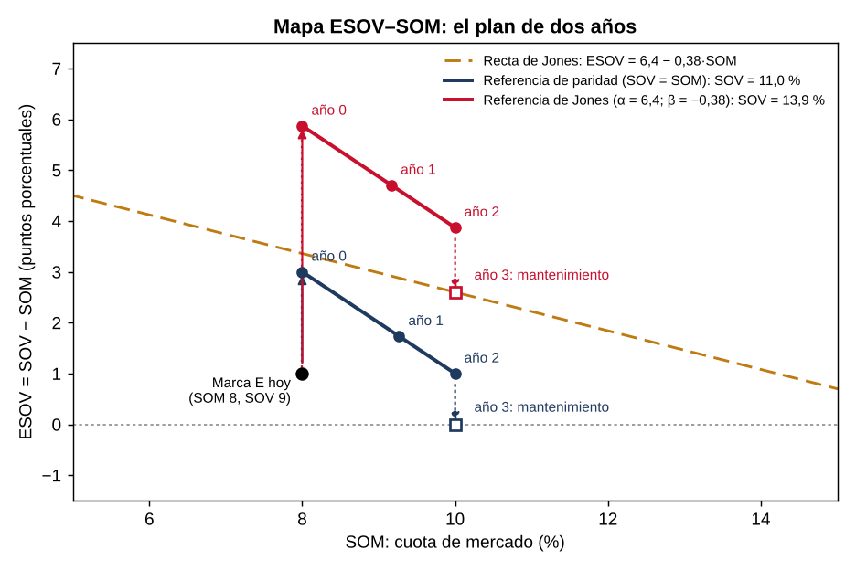
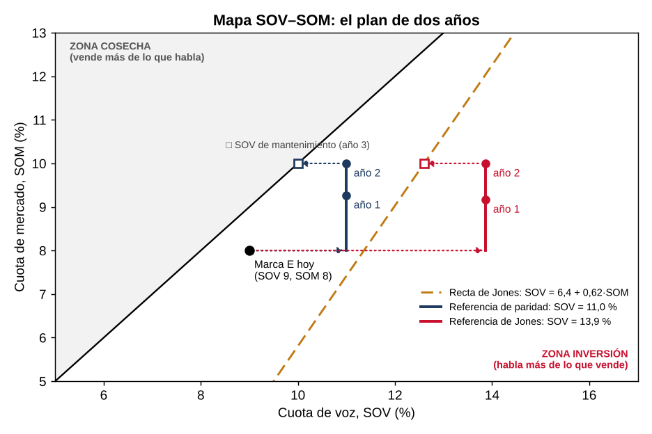

```{r setup, include=FALSE}
knitr::opts_chunk$set(collapse = TRUE, comment = "#>", fig.path = "man/figures/README-",
                      fig.width = 7, fig.height = 4.6, dpi = 110, out.width = "90%")
options(width = 100)
library(mediaSOV)
tabla <- function(d, digitos = 4) {
  d <- as.data.frame(d); class(d) <- "data.frame"
  # Markdown de GitHub: tipografía compacta mediante <sub> y alineación numérica.
  numerica <- function(x) {
    v <- trimws(as.character(x))
    v <- v[!is.na(v) & !v %in% c("", "—", "NA")]
    length(v) > 0L && all(grepl("^([+−-]?[[:space:]]*[0-9]+([.,][0-9]+)?[[:space:]]*%?|\\[[^]]+\\]|[<>≤≥][[:space:]]*[0-9.,]+)$", v))
  }
  a <- ifelse(vapply(d, numerica, logical(1)), "r", "l")
  lineas <- knitr::kable(d, format = "pipe", row.names = FALSE, digits = digitos,
                         align = a, format.args = list(decimal.mark = ","))
  # kable escapa las barras verticales internas; no se deben dividir.
  compacta <- function(linea) {
    campos <- strsplit(linea, "(?<!\\\\)\\|", perl = TRUE)[[1]]
    if (!length(campos) || !startsWith(linea, "|")) return(linea)
    campos <- trimws(campos[-1])
    if (all(grepl("^:?-+:?$", campos))) return(linea)
    paste0("| ", paste0("<sub>", campos, "</sub>", collapse = " | "), " |")
  }
  cat("\n", vapply(lineas, compacta, character(1)), sep = "\n")
  cat("\n\n")
}
ficha <- function(a) {
  if (is.null(a)) { cat("Sin estimación.\n"); return(invisible(NULL)) }
  tabla(data.frame(Indicador = names(a), Valor = vapply(a, function(v)
    paste(format(v, digits = 8, decimal.mark = ","), collapse = "; "), character(1))))
}
resultados <- function(x) {
  t <- sov_tabla(x, "resultados")
  cat("\n**Estimación e inferencia clásica**\n")
  tabla(t[, c(1, 2, 3, 4, 6, 7, 11)])
  cat("\n**Robustez y sensibilidad**\n")
  tabla(t[, c(1, 5, 8, 9, 10)])
}
```

# mediaSOV

**Análisis y simulación de la relación entre cuota de voz (SOV) y cuota de mercado (SOM) en planificación de medios**, diseñado para usarse sin conocimientos avanzados de R y con el rigor metodológico que exige una publicación académica o un informe profesional.

> Los resultados se generan desde el código de este documento mediante knitr; las tablas solo editan la presentación.

## Índice

1. [¿Qué hace el paquete?](#1-qué-hace-el-paquete)
2. [Instalación](#2-instalación)
3. [Inicio rápido (2 minutos)](#3-inicio-rápido-2-minutos)
4. [Sus propios datos](#4-sus-propios-datos)
5. [Análisis: `sov_analiza()` y su lectura](#5-análisis-sov_analiza-y-su-lectura)
6. [Tablas](#6-tablas)
7. [Gráficos](#7-gráficos)
8. [Funciones de análisis por separado](#8-funciones-de-análisis-por-separado)
9. [Informe HTML y asistente interactivo](#9-informe-html-y-asistente-interactivo)
10. [Datos sintéticos](#10-datos-sintéticos)
11. [Estudio de recuperación (validación del método)](#11-estudio-de-recuperación-validación-del-método)
12. [Cómo interpretar los resultados](#12-cómo-interpretar-los-resultados)
13. [Cuánto SOV invertir: el método Peckham 1,5 ampliado](#13-cuánto-sov-invertir-el-método-peckham-15-ampliado)
14. [Referencia de funciones](#14-referencia-de-funciones)
15. [Solución de problemas](#15-solución-de-problemas)
16. [Limitaciones y procedencia de los datos](#16-limitaciones-y-procedencia-de-los-datos)
17. [Cita, licencia y contribuciones](#17-cita-licencia-y-contribuciones)

---

## 1. ¿Qué hace el paquete?

Una marca invierte en publicidad una proporción del total de su categoría (**SOV**, *share of voice*) y tiene una cuota de ventas (**SOM**, *share of market*). La diferencia **ESOV = SOV − SOM** (exceso de cuota de voz, en puntos porcentuales) indica si invierte más o menos de lo que le correspondería por su tamaño. **mediaSOV** estima, por categoría, el modelo

$$\mathrm{ESOV}_i = \alpha + \beta\,\mathrm{SOM}_i + \varepsilon_i$$

y responde a la pregunta clásica de la curva de intensidad publicitaria de Jones (1990): ¿invierten las marcas grandes proporcionalmente menos que las pequeñas (**β < 0**)?

| <sub>Módulo</sub> | <sub>Qué ofrece</sub> |
| :--- | :--- |
| <sub>Lectura</sub> | <sub>CSV con separador `;` o `,`, decimal coma o punto, UTF-8 o Latin-1, nombres de columna flexibles</sub> |
| <sub>Análisis</sub> | <sub>MCO, errores robustos HC3, Theil-Sen, validación dejando una marca fuera, influencia (palanca, Cook, DFBETAS), bootstrap de pares, formas funcionales (AICc y validación cruzada), elasticidad log-log, homogeneidad de pendientes</sub> |
| <sub>Salidas</sub> | <sub>Tablas (data.frame o HTML), gráficos, lectura en lenguaje llano, informe HTML autocontenido</sub> |
| <sub>Interfaz</sub> | <sub>Aplicación Shiny (`sov_asistente()`) sin escribir código</sub> |
| <sub>Simulación</sub> | <sub>Datos sintéticos con verdad conocida bajo 5 postulados estáticos y 2 dinámicos, parámetros editables con procedencia, calibración con datos reales y estudio de recuperación</sub> |

## 2. Instalación

### 2.1 Requisitos

- **R ≥ 4.1.0** (https://cran.r-project.org). Recomendado: **RStudio** (https://posit.co/download/rstudio-desktop/), que además incluye Pandoc, necesario para el informe HTML.
- Conexión a internet para la instalación.

### 2.2 Instalación desde GitHub (recomendada)

Copie y pegue estas líneas en la consola de R:

```r
install.packages("remotes")                       # solo la primera vez
remotes::install_github("majesus/mediaSOV")
```

Para instalar también las viñetas (más lento):

```r
remotes::install_github("majesus/mediaSOV", build_vignettes = TRUE)
```

Paquetes opcionales, necesarios solo para algunas funciones (`sov_informe()` y `sov_asistente()`):

```r
install.packages(c("rmarkdown", "knitr", "shiny"))
```

### 2.3 Instalación alternativa sin `remotes`

Descargue el repositorio como ZIP desde GitHub (botón verde *Code* → *Download ZIP*), descomprímalo y ejecute desde la carpeta que lo contiene:

```r
install.packages("ruta/a/mediaSOV-main", repos = NULL, type = "source")
```

### 2.4 Comprobar que funciona

```r
library(mediaSOV)
packageVersion("mediaSOV")
```

```{r version}
packageVersion("mediaSOV")
```

Para actualizar a una versión más reciente, repita la orden de `install_github()`.

## 3. Inicio rápido (2 minutos)

```r
library(mediaSOV)
sov_demo()          # recorrido guiado con datos reales y sintéticos
sov_asistente()     # aplicación en el navegador, sin escribir código
```

El mismo análisis en dos pasos. Las funciones auxiliares `tabla()`, `ficha()` y `resultados()` que se emplean al compilar este README solo dan formato; no forman parte de la API del paquete. Se definen en el bloque inicial de [README.Rmd](README.Rmd).

```{r rapido, results='asis'}
x <- sov_analiza(adage2019, B = 300)
tabla(sov_tabla(x, "resultados")[, c(1, 2, 3, 4, 11)])
```

## 4. Sus propios datos

### 4.1 Formato del archivo

Una fila por marca, con **cuatro columnas obligatorias**:

| <sub>Columna</sub> | <sub>Contenido</sub> | <sub>Variantes de nombre admitidas (ejemplos)</sub> |
| :--- | :--- | :--- |
| <sub>categoría</sub> | <sub>Mercado o sector al que pertenece la marca</sub> | <sub>`categoria`, `sector`, `category`</sub> |
| <sub>marca</sub> | <sub>Nombre de la marca</sub> | <sub>`marca`, `brand`</sub> |
| <sub>SOM</sub> | <sub>Cuota de mercado, **en %** (0–100)</sub> | <sub>`som`, `cuota_mercado`, `market_share`</sub> |
| <sub>SOV</sub> | <sub>Cuota de voz, **en %** (0–100)</sub> | <sub>`sov`, `cuota_voz`, `share_of_voice`</sub> |

Si trabaja con la estructura de Ad Age (columnas `market_share_pct`, `media_musd`, etc.), el paquete también la reconoce y calcula las cuotas de voz.

**Reglas que conviene respetar:**

- Cada categoría necesita **al menos 4 marcas**; con menos se omite y el paquete lo avisa.
- **No incluya la fila «resto del mercado»**: no es una marca y, como las cuotas suman 100 %, fuerza mecánicamente la recta. Solo se incluye con `incluir_resto = TRUE` (no recomendado).
- Las cuotas van en **puntos porcentuales** (35, no 0,35). Los valores fuera de 0–100 generan un aviso.
- Si sus datos están en Excel (.xlsx), expórtelos antes a CSV (*Archivo → Guardar como → CSV*).

### 4.2 Crear una plantilla

```{r plantilla}
ruta <- sov_plantilla(file.path(tempdir(), "mis_datos.csv"))
cat(readLines(ruta, n = 8, encoding = "UTF-8"), sep = "\n")
```

La plantilla se guarda con separador `;`, coma decimal y marca de orden de bytes (BOM), de modo que **Excel la abre correctamente** en configuración regional española. Sustituya las cifras ficticias por las suyas, **conservando los nombres de columna**, y guárdela como CSV.

Sin argumentos, `sov_plantilla()` crea `plantilla_sov.csv` en el directorio de trabajo (`getwd()`).

### 4.3 Leer y analizar

```r
x <- sov_analiza("mis_datos.csv")
```

Si el análisis no se lee como esperaba, inspeccione cómo interpreta el archivo:

```{r lee}
d <- sov_lee(ruta)       # tabla tal como figura en el archivo
head(d, 3)
p <- sov_prepara(d)      # datos estandarizados: caso, sector, marca, som, sov, esov...
p
```

La salida de `sov_prepara()` resume, por categoría, el número de marcas y la suma de cuotas cubierta. También admite un `data.frame` ya cargado en R:

```r
x <- sov_analiza(mi_data_frame)
```

### 4.4 Datos de ejemplo incluidos

```{r ejemplo}
dim(adage2019)                # 60 filas x 13 columnas (Ad Age, 2019)
head(adage2019[, c("case_id", "brand", "market_share_pct", "media_musd", "is_rest")])
sov_ejemplo()                 # ruta del CSV de ejemplo incluido en el paquete
```

Se muestran las seis primeras filas y las columnas esenciales (`head()` oculta el resto): cada fila es una marca de una categoría (`case_id`); `market_share_pct` es la cuota de mercado en porcentaje de la categoría y `media_musd` la inversión publicitaria en millones de dólares, de la que `sov_analiza()` calcula la cuota de voz. La columna `is_rest` vale 1 en la fila «resto del mercado», que se excluye del análisis. Las demás columnas (`case_title`, `sector`, `pdf_page`, `share_basis`, `industry_media_total_musd`, `owner`, `focal`, `note`) documentan la procedencia.

## 5. Análisis: `sov_analiza()` y su lectura

```r
x <- sov_analiza(datos, nivel = 0.95, B = 2000, semilla = 2019,
                 incluir_resto = FALSE)
```

| <sub>Argumento</sub> | <sub>Significado</sub> |
| :--- | :--- |
| <sub>`datos`</sub> | <sub>Ruta de un CSV, `data.frame` o resultado de `sov_prepara()`/`sov_simula()`</sub> |
| <sub>`nivel`</sub> | <sub>Nivel de confianza de los intervalos (0,95 por defecto)</sub> |
| <sub>`B`</sub> | <sub>Remuestras del bootstrap (2000 por defecto; `0` lo omite y acelera)</sub> |
| <sub>`semilla`</sub> | <sub>Semilla del bootstrap (el generador del usuario se restaura al terminar)</sub> |
| <sub>`incluir_resto`</sub> | <sub>`TRUE` para incluir la fila «resto del mercado» (no recomendado)</sub> |

### 5.1 Resumen

```{r print, results='asis'}
resultados(x)
```

### 5.2 Lectura en lenguaje llano

`sov_interpreta()` redacta, para cada categoría, qué indican los coeficientes, cuán robustos son y qué marcas revisar:

```{r interpreta, results='asis'}
cat(sov_interpreta(x)[1:2], sep = "\n\n")
```

### 5.3 Cómo acceder a los resultados numéricos

El objeto `x` es una lista; cada categoría está en `x$sectores`:

```{r acceso, results='asis'}
a <- x$sectores$auto_marcas$ajuste
ficha(a[c("n", "alfa", "beta", "ic_beta", "p_beta", "r2", "ts_beta", "ic_beta_hc3")])
```

## 6. Tablas

`sov_tabla(x, tipo, categoria, formato)` produce seis tipos de tabla, como `data.frame` de caracteres con formato español (coma decimal) o como HTML autocontenido (`formato = "html"`) para pegar en un documento:

| <sub>`tipo`</sub> | <sub>Contenido</sub> |
| :--- | :--- |
| <sub>`"resultados"`</sub> | <sub>β, IC clásico y robusto HC3, p, R², Theil-Sen, rango al omitir cada marca, umbral de SOM</sub> |
| <sub>`"influencia"`</sub> | <sub>Palanca, t\*, Cook, DFBETAS y β sin cada marca, con alertas</sub> |
| <sub>`"formas"`</sub> | <sub>Comparación de formas funcionales (RMSE de validación cruzada, ΔAICc)</sub> |
| <sub>`"bootstrap"`</sub> | <sub>Intervalos bootstrap percentil de MCO y Theil-Sen</sub> |
| <sub>`"elasticidad"`</sub> | <sub>Elasticidad γ del modelo log-log</sub> |
| <sub>`"cobertura"`</sub> | <sub>Cobertura de cuotas de cada categoría</sub> |

```{r tablas, results='asis'}
resultados(x)
```

```{r tablas2, results='asis'}
t <- sov_tabla(x, "influencia", categoria = "restaurantes")
tabla(t[, c(2:5, 11)])
tabla(t[, c(2, 6:10)])
```

```{r tablas3, results='asis'}
tabla(sov_tabla(x, "formas", categoria = "auto_marcas"))
```

```{r tablas4, results='asis'}
tabla(sov_tabla(x, "elasticidad"))
```

```r
sov_tabla(x, "resultados", formato = "html")   # cadena HTML
```

## 7. Gráficos

Gráficos con R base (sin dependencias adicionales). Los datos simulados llevan automáticamente la marca de agua «DATOS SINTETICOS».

### 7.1 Dispersión por categoría

Recta de mínimos cuadrados con banda de confianza, recta de referencia de Jones (discontinua) y marcas con alerta de influencia en rojo:

```{r graf1}
sov_grafico(x, "auto_marcas")
```

```{r graf2}
sov_grafico(x, "restaurantes")
```

`sov_grafico(x)` sin categoría dibuja todas; `etiquetas = FALSE` suprime los nombres de marca.

### 7.2 Resumen de todas las categorías

```{r graf3}
sov_grafico_bosque(x)
```

### 7.3 Gráfico de método genérico

```r
plot(x)    # equivale a sov_grafico(x)
```

### 7.4 Guardar un gráfico

```r
png("auto.png", width = 1400, height = 900, res = 200)
sov_grafico(x, "auto_marcas")
dev.off()
```

### 7.5 Mapa SOV–SOM: `sov_mapa()`

```{r mapa, fig.width = 6.2, fig.height = 5.6}
sov_mapa(adage2019, "auto_marcas", marca = "Chevrolet")
```

Cada punto es una marca (SOV en abscisas, SOM en ordenadas). La diagonal es el equilibrio SOV = SOM (ESOV = 0): por encima, zona de cosecha; por debajo, zona de inversión. La línea roja discontinua es la aproximación lineal a la curva de Jones (1990), ESOV = α + β·SOM, trasladada a este plano como SOV = α + (1 + β)·SOM; se desactiva con `jones = FALSE`. Sus valores (α = +6,4; β = −0,38) definen la recta de mínimos cuadrados ajustada a la tabla de Jones (1990, p. 40).

## 8. Funciones de análisis por separado

Cada pieza se puede usar de forma independiente con vectores numéricos. En los ejemplos, `som`, `sov` y `esov` son de la categoría Automoción.

```{r vectores}
z <- x$sectores$auto_marcas$datos
som <- z$som; sov <- z$sov; esov <- z$esov; marca <- z$marca
```

**Ajuste por mínimos cuadrados con errores robustos y Theil-Sen** (`sov_ajusta`):

```{r ajusta, results='asis'}
a <- sov_ajusta(som, esov)
tabla(data.frame(Método = c("MCO", "MCO + HC3"), beta = a$beta,
  EE = c(a$se_beta, a$se_beta_hc3), p = c(a$p_beta, a$p_beta_hc3),
  IC = c(mediaSOV:::fmt_ic(a$ic_beta, 4), mediaSOV:::fmt_ic(a$ic_beta_hc3, 4))))
```

**Estimador de Theil-Sen** (mediana de las pendientes por pares; poco sensible a extremos):

```{r ts, results='asis'}
tabla(as.data.frame(as.list(sov_theil_sen(som, esov))))
```

**Influencia** (palanca, t\* estudentizado, Cook, DFBETAS, β al omitir la marca):

```{r infl, results='asis'}
i <- sov_influencia(som, esov, marca, sov)
tabla(i[, c("marca", "som", "sov", "esov", "residuo")], 2)
tabla(i[, c("marca", "palanca", "t_stud", "cook", "dfbetas", "beta_sin", "alerta")], 3)
```

**Bootstrap de pares** (no supone normalidad):

```{r boot, results='asis'}
b <- sov_bootstrap(som, esov, B = 500, semilla = 1)
tabla(data.frame(Método = c("MCO", "Theil-Sen"), IC = c(mediaSOV:::fmt_ic(b$ols, 4), mediaSOV:::fmt_ic(b$ts, 4))))
```

**Formas funcionales alternativas** (lineal, ln SOM, cuadrática), con RMSE de validación cruzada dejando una marca fuera (PRESS) y AICc:

```{r formas, results='asis'}
tabla(sov_formas(som, esov), 2)
```

**Elasticidad** (modelo log-log, SOV = c · SOM<sup>γ</sup>; γ < 1 indica economías de escala):

```{r elast, results='asis'}
ficha(sov_elasticidad(som, sov))
```

**Homogeneidad de pendientes** entre categorías (contraste F de pendientes comunes):

```{r hetero, results='asis'}
ficha(sov_heterogeneidad(x$datos))
```

## 9. Informe HTML y asistente interactivo

### 9.1 Informe

```r
sov_informe(x, archivo = "informe.html", titulo = "Mi informe", autor = "Su nombre")

# Con la marca y la categoría que se quieren seguir en la guía 1
sov_informe(adage2019, archivo = "informe.html",
            categoria = "auto_marcas", marca = "Chevrolet",
            epsilon = 0.05, anios = 3, inversion = 50)
```

Genera un HTML autocontenido (se puede enviar por correo) con resumen, **dos guías paso a paso** (véase 9.2), lectura en lenguaje llano, tablas, gráficos, diagnóstico de influencia, formas funcionales, elasticidad, glosario, limitaciones y referencias. Si los datos son sintéticos, el informe lo indica en un recuadro destacado e incluye el postulado, los parámetros y su procedencia. Requiere `rmarkdown`, `knitr` y Pandoc (incluido en RStudio).

### 9.2 Guías paso a paso: `sov_guia()`

Las guías están pensadas para estudiantes y para quien no es experto: acompañan la lectura de los datos con un tono didáctico, una pregunta por paso y un recuadro con el resultado. Todas las cifras, las figuras y las advertencias se generan a partir de **sus** datos, de modo que el texto cambia cuando cambia el resultado (por ejemplo, si una sola marca decide el signo de la pendiente).

```r
x <- sov_analiza(adage2019)

# Guía 1 (10 pasos): ¿invierte esta marca lo que cabría esperar de una marca de su tamaño?
sov_guia(x, "marca", categoria = "auto_marcas", marca = "Chevrolet")

# Guía 2 (11 pasos): ¿podemos fiarnos de la recta calculada con pocas marcas?
sov_guia(x, "sector", categoria = "auto_marcas")

# Página HTML independiente, o versión en texto plano
sov_guia(x, "marca", "auto_marcas", "Chevrolet", archivo = "guia_chevrolet.html")
sov_guia(x, "sector", "auto_marcas", formato = "texto")
```

La guía 1 recorre SOM, SOV, ESOV, el mapa, la referencia de Jones, una segunda referencia (la regresión de la propia categoría), la proyección con la elasticidad ε y la palanca de inversión. La guía 2 recorre la nube de puntos, la recta, la lectura de α y β, la confianza (error estándar, intervalo, HC3, bootstrap), la comparación entre categorías, el análisis dejando fuera una marca cada vez, los diagnósticos de influencia, Theil-Sen y recta frente a curva. Las guías recuerdan que ε = 0,05 es un supuesto operativo, no una estimación, y señalan con un recuadro los datos sintéticos.

### 9.3 Asistente sin código

```r
sov_asistente()
```

Abre en el navegador una aplicación con tres orígenes de datos (ejemplo real, CSV propio con descarga de plantilla, o datos sintéticos), selector de nivel de confianza y bootstrap, pestañas de lectura, resultados, gráfico, influencia, guía paso a paso, glosario y ayuda, y descarga del informe HTML. Requiere `shiny`.

### 9.4 Glosario

```{r glosario, results='asis'}
tabla(sov_glosario("beta"))
```

## 10. Datos sintéticos

> **Los datos sintéticos no son evidencia empírica.** Sirven para (i) comprobar que un método recupera una verdad conocida bajo un supuesto explícito y (ii) reproducir órdenes de magnitud calibrados con datos publicados. Nunca para afirmar nada sobre un mercado real.

### 10.1 Postulados disponibles

```{r postulados, results='asis'}
tabla(sov_postulados()[, c("id", "nombre", "tipo", "formulacion")])
```

### 10.2 Generar datos

```{r simula, results='asis'}
s <- sov_simula("jones_lineal", semilla = 2019)
cat("**Datos sintéticos.**\n")
tabla(sov_tabla(sov_analiza(s, B = 0), "cobertura"))
```

Cada categoría tiene cuotas que suman exactamente 100 % (mercado cerrado) y el SOV se genera con ruido de Dirichlet (Morais et al., 2017), que preserva el cierre sin sesgo en la media. La **verdad conocida** está en el atributo `simulacion`:

```{r verdad, results='asis'}
sim <- attr(s, "simulacion")
cat("Postulado: ", sim$postulado, ". Semilla: ", sim$semilla, ".\n", sep = "")
tabla(sim$verdad[, c("caso", "beta_lineal_publicadas", "cobertura_som")], 2)
```

Se analizan con las mismas funciones que los datos reales, y todo resultado derivado se rotula como sintético:

```{r sim-analiza, results='asis'}
xs <- sov_analiza(s, B = 0)
cat("**Datos sintéticos.**\n")
tabla(sov_tabla(xs, "resultados")[, 1:5])
```

La misma semilla reproduce exactamente los mismos datos; el generador de números aleatorios del usuario no se altera.

### 10.3 Parámetros y su procedencia

```{r parametros, results='asis'}
p <- sov_parametros("jones_lineal")
tabla(p$procedencia)
```

Cada parámetro indica su valor, su procedencia (calibración con Ad Age 2019, valor de la literatura, supuesto operativo o valor del usuario) y la fuente. Se modifican por nombre:

```r
s2 <- sov_simula("jones_lineal", semilla = 1, beta = -0.5, kappa = 300, n_categorias = 12)
```

Los parámetros modificados quedan registrados como procedencia «usuario». También se puede construir el objeto de parámetros primero y reutilizarlo:

```r
p <- sov_parametros("jones_lineal", beta = -0.5)
s3 <- sov_simula("jones_lineal", parametros = p, semilla = 2)
```

Todos los postulados estáticos se generan igual cambiando el identificador: `"paridad"`, `"jones_heterogeneo"`, `"potencia"`, `"curvilinea"`.

### 10.4 Calibración con los datos reales

```{r calibra, results='asis'}
cal <- sov_calibra()
tabla(cal$por_caso[, -1], 3)
ficha(cal$resumen)
```

Estima, por método de momentos y por categoría, el tamaño del mercado (`theta`), la dispersión de las cuotas, la elasticidad `gamma`, la precisión del ruido (`kappa`) y la pendiente `beta`. Admite sus propios datos: `sov_calibra(sus_datos)`, y `sov_parametros("jones_lineal", calibrar_con = sus_datos)` los usa directamente.

### 10.5 Simulación dinámica (panel temporal)

Para estudiar si el exceso de voz hace crecer la cuota de mercado en el tiempo:

```{r dinamica, results='asis'}
d <- sov_simula_dinamica("elasticidad", semilla = 11)
cat("**Datos sintéticos.**\n")
tabla(head(d[, c("marca", "periodo", "som", "sov", "esov")]), 2)
ficha(sov_efecto_esov(d))
```

Con `"equilibrio"` (η = 0, Graham, 2009) el efecto estimado debe ser nulo; con `"elasticidad"` (η = 0,24) debe aproximarse a ese valor. La elasticidad 0,24 es un **supuesto operativo** inspirado en Sethuraman et al. (2011), no una estimación propia.

## 11. Estudio de recuperación (validación del método)

`sov_valida_simulacion()` repite la simulación `R` veces y mide el sesgo, el error cuadrático y la **cobertura** de los intervalos (cuántas veces contienen el valor verdadero):

```r
sov_valida_simulacion("jones_lineal", R = 500, B = 500, semilla = 11)
```

```{r valida, results='asis'}
v <- sov_valida_simulacion("jones_lineal", R = 100, semilla = 11, B = 200)
tabla(v$resumen)
```

Una cobertura cercana al 95 % indica que los intervalos son fiables bajo ese postulado. Los resultados dependen de `R`, de la semilla y de los parámetros; el `error_mc` es la incertidumbre de Monte Carlo. Con `R` pequeño (como en este ejemplo) las cifras son aproximadas; para resultados citables use `R ≥ 500`.

**Lectura de este resultado.** El estimador de la pendiente es prácticamente insesgado, pero el intervalo **clásico** de MCO cubre menos del 95 % nominal con 6–10 marcas por categoría, mientras que el intervalo robusto HC3 y el bootstrap se aproximan más. Por eso el paquete muestra siempre ambos intervalos.

## 12. Cómo interpretar los resultados

- **β < 0 con IC que excluye 0**: las marcas grandes invierten proporcionalmente menos (economías de escala en el sentido de Jones). **β > 0**: lo contrario. **IC que contiene 0**: el gasto es aproximadamente proporcional a la cuota.
- Como SOM figura en ambos lados de la ecuación, β se interpreta frente a SOV = SOM (β = 0), **no frente a 0 en SOV**.
- **Robustez**: compare el IC clásico con el HC3, Theil-Sen y el bootstrap. Si el signo cambia al omitir una marca (columna «β al omitir cada marca»), el resultado depende de esa marca y debe tomarse con cautela.
- **Umbral de SOM**: cuota en la que el ESOV medio se anula; por encima, las marcas invierten de media menos de lo que su cuota sugiere.
- **Alertas de influencia**: P = palanca alta; A = residuo atípico; I = influencia sobre la pendiente (Cook o DFBETAS). Son umbrales heurísticos: revise los datos de esas marcas antes de decidir.
- **Formas funcionales**: si la forma lineal no es la mejor por RMSE y AICc, la relación puede no ser lineal.
- Una asociación entre ESOV y SOM **no demuestra causalidad**.

## 13. Cuánto SOV invertir: el método Peckham 1,5 ampliado

Los apartados anteriores diagnostican dónde está una marca. Este responde a la pregunta que sigue al diagnóstico: **qué cuota de voz debe sostener durante los próximos dos años para alcanzar una cuota de mercado objetivo**, cuánto presupuesto supone y cómo se desplazará la marca en el mapa ESOV–SOM (el de la recta de Jones, `sov_grafico()`) y en el mapa SOV–SOM (`sov_mapa()`). El punto de partida es la regla clásica de Peckham; el resultado es una fórmula que la contiene como caso particular y que incorpora lo que esa regla no considera.

### 13.1 La regla de partida y sus tres silencios

La regla del 1,5 procede de Peckham (1975/1981), que estudió con los datos del índice de detallistas de Nielsen la evolución de las ventas de marcas de gran consumo: una marca nueva que aspira a una cuota de mercado $s^\ast$ debe sostener durante unos dos años una cuota de voz de $1{,}5\,s^\ast$. Jones (1990, p. 39) recoge el mismo principio al señalar que Nielsen recomendaba desde hacía tiempo dotar a las marcas nuevas de una voz superior a su cuota. Danenberg et al. (2016) sitúan en los trabajos de Peckham de los años setenta el arranque del uso de la relación entre SOV y SOM como criterio presupuestario, y emparentan su propio análisis longitudinal con la «diferencia dinámica» que Peckham propuso (pp. 139, 141).

La regla debe su difusión a que comprime una decisión compleja en un solo número. Esa compresión tiene un precio: guarda silencio sobre tres variables que alteran la respuesta.

**El punto de partida.** La regla prescribe lo mismo a una marca que nace que a otra que ya posee el 8 % y desea el 10 %; la cuota actual no interviene en el cálculo.

**El tamaño de la marca.** El equilibrio implícito es SOV = SOM. La curva de intensidad publicitaria de Jones (1990) describe otra cosa: las marcas pequeñas tienden a invertir por encima de su cuota, y las grandes se sostienen por debajo de ella sin perder posición (pp. 39–41). Schroer (1990) comparte la segunda parte, porque el líder disfruta de una ventaja de escala, pero discute que los competidores pequeños deban sobreinvertir para atacar a los líderes. Danenberg et al. (2016) observan esa forma descendente en bebidas refrescantes y en proveedores de internet de once países, también en medios distintos de la televisión, si bien la pendiente y el intercepto cambian entre categorías, países y años, de modo que no existe una recta universal (pp. 142, 144).

**La velocidad de respuesta.** La regla no indica con qué rapidez responde la cuota al exceso de voz. El documento aporta un orden de magnitud para bienes de consumo envasado: alrededor de medio punto de cuota al año por cada 10 puntos de ESOV, con el ESOV medido frente a SOV = SOM (Field, 2009, citado en Danenberg et al., 2016, p. 140).

### 13.2 El modelo: la cuota persigue a la voz

Sea $s(t)$ la cuota de mercado de la marca, en %, y $v$ la cuota de voz que sostiene. El modelo supone que la cuota crece en proporción a la distancia entre la voz comprada y la voz que su tamaño exige:

$$\frac{ds}{dt} \;=\; k\,\bigl[\,v - v^{\ast}(s)\,\bigr], \qquad v^{\ast}(s) \;=\; \alpha + (1+\beta)\,s .$$

El término $v^{\ast}(s)$ es la **SOV de mantenimiento**: la voz con la que una marca de cuota $s$ ni gana ni pierde. Procede de la misma recta que estima `sov_analiza()`, ESOV = α + β·SOM, trasladada al plano SOV–SOM como hace `sov_mapa()`. Admite dos referencias. La **referencia de paridad** (α = β = 0, esto es, SOV = SOM) es el criterio con el que Binet y Field calcularon el exceso de voz (Danenberg et al., 2016, p. 140). La **referencia de Jones**, o la recta propia de la categoría, es la que Danenberg et al. (2016) consideran más prometedora como equilibrio, aunque en sus datos el respaldo empírico a esa ventaja sobre la paridad fue débil (pp. 140, 143).

El parámetro $k$ es la **velocidad de respuesta**: puntos de cuota ganados al año por cada punto de voz por encima del mantenimiento. Con la referencia de paridad, la cifra de Field se traduce de forma directa, 0,5 / 10, en **k ≈ 0,05**, valor que el propio documento equipara a una elasticidad publicitaria de 0,05 (Danenberg et al., 2016, p. 140).

Una magnitud auxiliar facilita la intuición: la **semivida** de la brecha, $\ln 2 / [k(1+\beta)]$, es el tiempo que la marca tarda en recorrer la mitad del camino hacia la cuota que su voz puede sostener. Con k = 0,05 y paridad, la semivida se acerca a catorce años; en una marca establecida, la cuota se desplaza con lentitud.

### 13.3 La fórmula de los dos años

Si la marca sostiene una SOV constante $v$ durante $T$ años, la ecuación tiene solución cerrada y puede despejarse la voz que conduce de la cuota actual $s_0$ a la cuota objetivo $s^\ast$ de forma explícita:

$$v \;=\; \underbrace{v^{\ast}(s^{\ast})}_{\text{mantenimiento en el objetivo}} \;+\; \underbrace{(1+\beta)\,(w-1)\,(s^{\ast}-s_0)}_{\text{prima de crecimiento}}, \qquad w \;=\; \frac{1}{1-e^{-k(1+\beta)T}} .$$

La SOV del plan se descompone, por tanto, en dos sumandos con significado propio: la voz que hará falta para conservar la cuota objetivo una vez alcanzada y una **prima de crecimiento** proporcional a los puntos por ganar. El **multiplicador** $w$ resume en un solo número la velocidad de la categoría y la paciencia del plan: cuanto más lenta la respuesta o más corto el horizonte, mayor es $w$ y más cara cada décima de cuota.

**La regla de Peckham como caso particular.** Con la referencia de paridad, una marca que parte de cero ($s_0 = 0$) y un horizonte de dos años, la fórmula se reduce a $v = w\,s^\ast$. La regla de Peckham equivale a $w = 1{,}5$, es decir, a $e^{-2k} = 1/3$ y $k = \ln 3 / 2 \approx 0{,}55$ al año, con una semivida de 1,3 años: esa es la velocidad de respuesta que la regla presupone. Con esa misma velocidad, la regla ampliada para cualquier punto de partida resulta

$$v \;=\; 1{,}5\,s^\ast \;-\; 0{,}5\,s_0 ,$$

que admite una lectura inmediata: **la cuota objetivo más medio punto de voz por cada punto de cuota que se quiere ganar**. Para $s_0 = 0$ reproduce exactamente la regla original.

La velocidad implícita en la regla de Peckham es unas diez veces la de Field. Ambas cifras describen regímenes distintos: la primera, lanzamientos; la segunda, marcas maduras de gran consumo. La diferencia es coherente con la regularidad de que las elasticidades publicitarias son menores en marcas grandes y consolidadas que en marcas pequeñas o nuevas (Danenberg et al., 2016, pp. 140, 144).

**Multiplicador w para un horizonte de dos años con referencia de paridad**

| <sub>k (puntos de SOM al año por punto de exceso)</sub> | <sub>Semivida</sub> | <sub>w</sub> | <sub>Lectura</sub> |
| ---: | ---: | ---: | :--- |
| <sub>0,05</sub> | <sub>13,9 años</sub> | <sub>10,5</sub> | <sub>Marca madura de gran consumo (orden de magnitud de Field)</sub> |
| <sub>0,10</sub> | <sub>6,9 años</sub> | <sub>5,5</sub> | <sub>Valor ilustrativo</sub> |
| <sub>0,25</sub> | <sub>2,8 años</sub> | <sub>2,5</sub> | <sub>Valor ilustrativo</sub> |
| <sub>0,55</sub> | <sub>1,3 años</sub> | <sub>1,5</sub> | <sub>Velocidad implícita en la regla de Peckham</sub> |

### 13.4 Calibrar k, el parámetro decisivo

Toda la fórmula depende de $k$, y conviene estimarlo antes que suponerlo. Si se dispone de un **panel** de la categoría (varios años de SOV y SOM por marca), `sov_efecto_esov()` estima η en $d\ln\mathrm{SOM} = \eta\,\ln(\mathrm{SOV}/\mathrm{SOM})$ (apartado 10.5). Cuando SOV y SOM son próximas, $\ln(v/s) \approx (v-s)/s$ y, por tanto, $ds/dt \approx \eta\,(v-s)$: **el η estimado puede emplearse como k con la referencia de paridad**, expresado en la periodicidad del panel; la aproximación es tanto más fiel cuanto menor sea la distancia entre voz y cuota.

Sin panel, lo prudente es **acotar** el presupuesto con los dos anclajes de la tabla anterior, 0,05 y 0,55, y tratar el intervalo resultante como el rango de decisiones defendibles. Dos cautelas completan el cuadro. La primera: un $k$ estimado frente a la paridad no es trasladable sin más a la referencia de Jones,, porque mide la respuesta a otro exceso; con la referencia de Jones, $k$ debe estimarse frente a esa recta. La segunda: la respuesta a la publicidad es heterogénea y no siempre detectable; en el metaanálisis de Sethuraman et al. (2011), poco más de la mitad de las 437 elasticidades con error típico calculable resultaron significativamente mayores que cero al 95 % (citado en Danenberg et al., 2016, p. 145).

### 13.5 Ejemplo resuelto: Marca E, del 8 % al 10 % en dos años

Marca E es la marca ficticia de `sov_plantilla()`: SOM del 8 % y SOV del 9 %, con un ESOV de +1 punto. El objetivo es una cuota del 10 % al cierre del segundo año. Para la recta de la categoría se toma la referencia de Jones que usa el paquete, α = 6,4 y β = −0,38: es la recta de mínimos cuadrados que ajusta las diferencias medias entre SOV y SOM de la tabla de Jones (1990, p. 40), con cada tramo de cuota situado en su punto medio.

*Paso a paso con la referencia de paridad y k = 0,55.* El multiplicador vale w = 1,5; la SOV de mantenimiento en el objetivo es v\*(10) = 10; la prima es 1 × 0,5 × 2 = 1. La SOV del plan es **11,0 %** en cada uno de los dos años.

*Paso a paso con la referencia de Jones y k = 0,55.* Ahora 1 + β = 0,62 y w = 1 / (1 − e<sup>−0,55 × 0,62 × 2</sup>) = 2,02; el mantenimiento en el objetivo es 6,4 + 0,62 × 10 = 12,6; la prima es 0,62 × 1,02 × 2 = 1,27. La SOV del plan es **13,9 %**.

*De la cuota de voz al presupuesto.* Si la competencia invierte $X$ y la marca $A$, entonces $v = A/(A+X)$ y

$$A \;=\; X\,\frac{v}{100-v}.$$

La relación no es lineal: con $X$ constante, pasar del 9 % al 11 % de SOV exige un 25 % más de inversión, no un 22 %. La tabla compara los planes con un índice de presupuesto en el que la inversión actual vale 100; las cuotas de los años 1 y 2 se calculan con el modelo correspondiente a cada fila.

| <sub>Plan</sub> | <sub>SOV, años 1 y 2</sub> | <sub>Presupuesto (hoy = 100)</sub> | <sub>SOM al cierre del año 1</sub> | <sub>SOM al cierre del año 2</sub> |
| :--- | ---: | ---: | ---: | ---: |
| <sub>Regla de Peckham (1,5 × 10), paridad, k = 0,55</sub> | <sub>15,0 %</sub> | <sub>178</sub> | <sub>11,0 %</sub> | <sub>12,7 %</sub> |
| <sub>Ampliado, paridad, k = 0,55</sub> | <sub>11,0 %</sub> | <sub>125</sub> | <sub>9,3 %</sub> | <sub>10,0 %</sub> |
| <sub>Ampliado, Jones, k = 0,55</sub> | <sub>13,9 %</sub> | <sub>163</sub> | <sub>9,2 %</sub> | <sub>10,0 %</sub> |
| <sub>Ampliado, paridad, k = 0,05</sub> | <sub>29,0 %</sub> | <sub>413</sub> | <sub>9,0 %</sub> | <sub>10,0 %</sub> |

La tabla admite tres lecturas. **Ignorar el punto de partida encarece el plan y lo desborda**: la regla original, aplicada a una marca que no nace de cero, cuesta 53 puntos de índice más que la versión ampliada y lleva la cuota al 12,7 %, por encima del objetivo. **La corrección de Jones eleva la factura**: con un 8 % de cuota, la recta de Jones fija el mantenimiento en una SOV del 11,4 %, de modo que la Marca E, con su 9 % actual, ya invierte por debajo de lo que su tamaño exige y parte de un déficit. **Con la velocidad de una marca madura, el objetivo deja de ser creíble**: cuadruplicar el presupuesto es una señal para revisar la meta o el horizonte, no para aprobar el gasto; con k = 0,05, la SOV del 15 % que prescribe la regla de Peckham solo llevaría la cuota al 8,7 %.

Schroer (1990) ofrece un contraste independiente de esa última lectura. En los mercados maduros de gran consumo que analizó, los cambios de cuota atribuibles a la publicidad solo aparecieron cuando un competidor sostuvo una prima de voz de 20 a 30 puntos del gasto total de la categoría, aproximadamente el doble que su rival principal, y aun así la correlación entre gasto y variación de cuota no pasó de 0,5. Aunque Schroer mide la prima frente al rival y no frente a la propia cuota, el orden de magnitud coincide con el que implica k = 0,05: veinte puntos de exceso de voz por cada punto de cuota ganado al año. El mismo autor sitúa la aparición de la relación entre gasto y cuota hacia los 18 meses y su confirmación fiable a partir de los tres años, de modo que un plan a dos años debe juzgarse al cierre del horizonte y no trimestre a trimestre.

### 13.6 Consecuencias en los mapas: salto, deslizamiento y aterrizaje

Un plan de este tipo dibuja en ambos mapas la misma secuencia de tres movimientos. Las figuras muestran la Marca E con las dos referencias y k = 0,55; el punto negro es la situación actual, los círculos marcan el inicio y el cierre de cada año, y el cuadrado, la SOV de mantenimiento a partir del tercer año.



**En el mapa ESOV–SOM.** El **salto** es vertical: el primer día la cuota no cambia y el ESOV aumenta en tantos puntos como SOV se añaden (+2 con paridad, +4,9 con Jones). El **deslizamiento** sigue una recta de pendiente −1, porque con la voz constante cada punto de cuota ganado resta un punto de ESOV; además, el avance se frena a medida que la marca se aproxima a su referencia (con paridad, 1,27 puntos de cuota el primer año y 0,73 el segundo). El **aterrizaje** es de nuevo vertical: al rebajar la voz al mantenimiento, el punto cae sobre la línea ESOV = 0 con paridad, o sobre la recta de Jones, a +2,6 puntos, con esa referencia.



**En el mapa SOV–SOM.** Los mismos movimientos giran noventa grados. El salto es horizontal y adentra a la marca en la zona de inversión; el deslizamiento es vertical, porque la voz no cambia mientras la cuota sube; el aterrizaje la devuelve hacia la izquierda, hasta la diagonal o hasta la recta de Jones. La distancia horizontal entre el tramo vertical y el cuadrado es, en cada año, la prima de crecimiento que se está pagando.

De esta geometría se desprenden dos consecuencias prácticas. La primera: **que el ESOV disminuya durante el plan no indica que el plan esté fallando**; es la consecuencia mecánica de crecer con la voz constante. La segunda: **el aterrizaje es parte del plan**. Si la marca no rebaja su voz al cierre del segundo año, sigue creciendo hacia la cuota en la que esa voz sería de mantenimiento, el 11,0 % con paridad o el 12,0 % con Jones, y paga por un crecimiento que no estaba en el objetivo.

### 13.7 Lo que el método no resuelve

El modelo supone que la respuesta es lineal en el exceso de voz. Danenberg et al. (2016) conjeturan que el efecto de un aumento de voz depende más de su distancia al equilibrio que del cambio proporcional, y piden comprobar si crece de forma monótona con esa distancia (p. 145); el método adopta esa hipótesis como supuesto de trabajo. La recta de mantenimiento varía con la categoría y con el año, y los autores desaconsejan sustituir la recta propia por la media de Jones cuando aquella puede estimarse (p. 144); con pocas marcas, el intervalo de β que ofrece `sov_analiza()` debe trasladarse a la SOV del plan. La cuota responde también a factores ajenos al peso publicitario, como la innovación o la entrada de competidores, que pesaron con claridad en los mercados de proveedores de internet estudiados (pp. 142–143). Las cuotas suman 100: si la competencia reacciona, el mismo presupuesto compra menos voz, y $A$ debe recalcularse con la previsión de $X$. Schroer (1990) añade tres matices. En equilibrio, las cuotas de los líderes apenas responden a cambios marginales de gasto, lo que cuestiona la linealidad del modelo para excesos pequeños. Una ofensiva tiende a provocar la respuesta de los rivales hasta que se restablece el equilibrio. Y estas relaciones operan mercado a mercado, no a escala nacional, de modo que el plan debe calcularse para cada mercado donde se compite. Advierte también que su lógica de voz relativa no se aplica a productos nuevos ni a nichos muy diferenciados, para los que recomienda invertir lo necesario para lograr alcance y frecuencia suficientes. Por último, la fórmula no maximiza beneficios: Danenberg et al. (2016) recomiendan no fijar el presupuesto con un único criterio y combinarlo con un cálculo de optimización del beneficio basado en elasticidades y con el método de objetivo y tarea (p. 145).

### 13.8 Referencias de este apartado

Danenberg, N., Kennedy, R., Beal, V., & Sharp, B. (2016). Advertising budgeting: A reinvestigation of the evidence on brand size and spend. *Journal of Advertising, 45*(1), 139–146. https://doi.org/10.1080/00913367.2015.1090938

Jones, J. P. (1990). Ad spending: Maintaining market share. *Harvard Business Review, 68*(1), 38–42.

Peckham, J. O. (1981). *The wheel of marketing: An analysis and interpretation of what generally happens to consumer sales of branded food products, household needs, toiletries, proprietary drug products… based on Nielsen retail index data*. Nielsen Marketing Research. (Obra original publicada en 1975; edición intermedia de 1978)

Schroer, J. C. (1990). Ad spending: Growing market share. *Harvard Business Review, 68*(1), 44–48.

## 14. Referencia de funciones

| <sub>Función</sub> | <sub>Para qué sirve</sub> |
| :--- | :--- |
| <sub>`sov_demo()`</sub> | <sub>Recorrido guiado de todo el flujo</sub> |
| <sub>`sov_asistente()`</sub> | <sub>Aplicación Shiny sin código</sub> |
| <sub>`sov_plantilla()`</sub> | <sub>Crea un CSV de muestra compatible con Excel</sub> |
| <sub>`sov_ejemplo()`</sub> | <sub>Ruta del CSV de ejemplo (Ad Age, 2019)</sub> |
| <sub>`adage2019`</sub> | <sub>Datos reales de ejemplo</sub> |
| <sub>`sov_lee()`</sub> | <sub>Lee un CSV (separador, decimal y codificación automáticos)</sub> |
| <sub>`sov_prepara()`</sub> | <sub>Estandariza y valida los datos</sub> |
| <sub>`sov_analiza()`</sub> | <sub>Análisis completo por categoría</sub> |
| <sub>`sov_interpreta()`</sub> | <sub>Lectura en lenguaje llano</sub> |
| <sub>`sov_tabla()`</sub> | <sub>Tablas de resultados (data.frame o HTML)</sub> |
| <sub>`sov_grafico()`, `sov_grafico_bosque()`, `sov_mapa()`, `plot()`</sub> | <sub>Gráficos (ESOV por SOM, bosque de pendientes, mapa SOV–SOM)</sub> |
| <sub>`sov_informe()`</sub> | <sub>Informe HTML autocontenido (incluye las dos guías)</sub> |
| <sub>`sov_guia()`</sub> | <sub>Guía paso a paso: de las cuotas a la brecha de una marca (`"marca"`) o de los puntos a la recta (`"sector"`)</sub> |
| <sub>`sov_ajusta()`, `sov_theil_sen()`, `sov_influencia()`, `sov_bootstrap()`, `sov_formas()`, `sov_elasticidad()`, `sov_heterogeneidad()`</sub> | <sub>Componentes del análisis con vectores</sub> |
| <sub>`sov_postulados()`</sub> | <sub>Catálogo de postulados de simulación</sub> |
| <sub>`sov_parametros()`</sub> | <sub>Parámetros y procedencia</sub> |
| <sub>`sov_calibra()`</sub> | <sub>Calibración con datos reales</sub> |
| <sub>`sov_simula()`, `sov_simula_dinamica()`</sub> | <sub>Generación de datos sintéticos</sub> |
| <sub>`sov_efecto_esov()`</sub> | <sub>Efecto del ESOV sobre la variación de cuota (panel)</sub> |
| <sub>`sov_valida_simulacion()`</sub> | <sub>Estudio de recuperación (sesgo, RMSE, cobertura)</sub> |
| <sub>`sov_referencias()`</sub> | <sub>Bibliografía del paquete</sub> |
| <sub>`sov_glosario()`</sub> | <sub>Definición de términos</sub> |

La ayuda de cada función está disponible con `?sov_analiza`, `help(package = "mediaSOV")` y `vignette("primeros-pasos", "mediaSOV")` (si instaló las viñetas).

### Referencias bibliográficas

```{r refs, results='asis'}
r <- sov_referencias()
for (i in seq_len(nrow(r))) cat("- ", r$cita[i], "\n", sep = "")
```

## 15. Solución de problemas

| <sub>Síntoma</sub> | <sub>Causa probable</sub> | <sub>Solución</sub> |
| :--- | :--- | :--- |
| <sub>`no se puede abrir el URL` / error en `install_github`</sub> | <sub>Sin conexión o proxy</sub> | <sub>Descargue el ZIP (apartado 2.3)</sub> |
| <sub>Error por Pandoc en `sov_informe()`</sub> | <sub>Pandoc no instalado</sub> | <sub>Use RStudio o instale Pandoc (https://pandoc.org/installing.html)</sub> |
| <sub>`Falta el paquete 'shiny'`</sub> | <sub>Paquete opcional ausente</sub> | <sub>`install.packages("shiny")`</sub> |
| <sub>«columna» no encontrada al leer</sub> | <sub>Nombres de columna no reconocidos</sub> | <sub>Renómbrelos (apartado 4.1) o use `sov_plantilla()`</sub> |
| <sub>Cifras 100 veces menores o mayores</sub> | <sub>Cuotas en proporción (0–1)</sub> | <sub>Multiplique por 100</sub> |
| <sub>«menos de 4 marcas»</sub> | <sub>Categoría con pocas marcas</sub> | <sub>Se omite; añada marcas o agrupe categorías</sub> |
| <sub>Acentos mal en consola de Windows</sub> | <sub>Codificación de la consola</sub> | <sub>El archivo se lee bien; use RStudio o `Sys.setlocale("LC_ALL", "es_ES.UTF-8")`</sub> |
| <sub>Excel muestra todo en una columna</sub> | <sub>Separador distinto del configurado</sub> | <sub>Use la plantilla del paquete o *Datos → Texto en columnas*</sub> |

Si el problema persiste, abra una *issue* en https://github.com/majesus/mediaSOV/issues indicando la salida de `sessionInfo()` y un ejemplo mínimo reproducible.

## 16. Limitaciones y procedencia de los datos

- Las cuotas de una categoría suman 100 %, por lo que SOV y SOM no son independientes y la relación puede contener efectos de cierre.
- Con 6–10 marcas por categoría, la potencia estadística es baja y el intervalo clásico tiende a ser demasiado estrecho; use también HC3, Theil-Sen y bootstrap.
- Los **datos reales de ejemplo** (Ad Age, 2019) se transcribieron a partir de material docente.
- Los coeficientes de la curva de referencia de Jones (α = 6,4; β = −0,38) son la recta de mínimos cuadrados ajustada a los diez tramos de cuota de la tabla de Jones (1990, p. 40), tomados en su punto medio. La curva original es cóncava (p. 41), de modo que la recta la aproxima.
- La SOV del plan del método Peckham 1,5 ampliado (apartado 13) depende de la velocidad de respuesta k, que debe calibrarse con datos de la categoría; los dos anclajes que se ofrecen son órdenes de magnitud.
- La elasticidad η = 0,24 de la simulación dinámica es un **supuesto operativo**.
- Los datos sintéticos no son evidencia empírica.

## 17. Cita, licencia y contribuciones

```r
citation("mediaSOV")
```

Licencia **MIT** (véase `LICENSE`). Sugerencias y errores: https://github.com/majesus/mediaSOV/issues.

Autor y mantenedor: Manuel Jesús Sánchez-Franco, Universidad de Sevilla.
