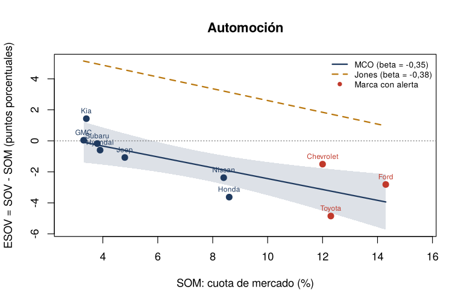
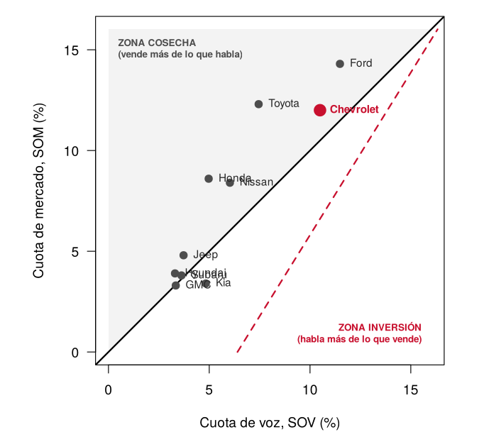

# mediaSOV

**Análisis y simulación de la relación entre cuota de voz (SOV) y cuota
de mercado (SOM) en planificación de medios**, diseñado para usarse sin
conocimientos avanzados de R y con el rigor metodológico que exige una
publicación académica o un informe profesional.

> Las cifras de las tablas proceden de los resultados ejecutados en la
> versión anterior del README. El archivo [README.Rmd](README.Rmd)
> permite regenerarlas con knitr; se ha renovado su presentación sin
> cambiar las estimaciones.

## Índice

1.  [¿Qué hace el paquete?](#1-qué-hace-el-paquete)
2.  [Instalación](#2-instalación)
3.  [Inicio rápido (2 minutos)](#3-inicio-rápido-2-minutos)
4.  [Sus propios datos](#4-sus-propios-datos)
5.  [Análisis: `sov_analiza()` y su
    lectura](#5-análisis-sov_analiza-y-su-lectura)
6.  [Tablas](#6-tablas)
7.  [Gráficos](#7-gráficos)
8.  [Funciones de análisis por
    separado](#8-funciones-de-análisis-por-separado)
9.  [Informe HTML y asistente
    interactivo](#9-informe-html-y-asistente-interactivo)
10. [Datos sintéticos](#10-datos-sintéticos)
11. [Estudio de recuperación (validación del
    método)](#11-estudio-de-recuperación-validación-del-método)
12. [Cómo interpretar los
    resultados](#12-cómo-interpretar-los-resultados)
13. [Referencia de funciones](#13-referencia-de-funciones)
14. [Solución de problemas](#14-solución-de-problemas)
15. [Limitaciones y procedencia de los
    datos](#15-limitaciones-y-procedencia-de-los-datos)
16. [Cita, licencia y
    contribuciones](#16-cita-licencia-y-contribuciones)

------------------------------------------------------------------------

## 1. ¿Qué hace el paquete?

Una marca invierte en publicidad una proporción del total de su
categoría (**SOV**, *share of voice*) y tiene una cuota de ventas
(**SOM**, *share of market*). La diferencia **ESOV = SOV − SOM** (exceso
de cuota de voz, en puntos porcentuales) indica si invierte más o menos
de lo que le correspondería por su tamaño. **mediaSOV** estima, por
categoría, el modelo

$$\mathrm{ESOV}_i = \alpha + \beta\,\mathrm{SOM}_i + \varepsilon_i$$

y responde a la pregunta clásica de la curva de intensidad publicitaria
de Jones (1990): ¿invierten las marcas grandes proporcionalmente menos
que las pequeñas (**β \< 0**)?

| Módulo     | Qué ofrece                                                                                                                                                                                                                         |
|------------|------------------------------------------------------------------------------------------------------------------------------------------------------------------------------------------------------------------------------------|
| Lectura    | CSV con separador `;` o `,`, decimal coma o punto, UTF-8 o Latin-1, nombres de columna flexibles                                                                                                                                   |
| Análisis   | MCO, errores robustos HC3, Theil-Sen, validación dejando una marca fuera, influencia (palanca, Cook, DFBETAS), bootstrap de pares, formas funcionales (AICc y validación cruzada), elasticidad log-log, homogeneidad de pendientes |
| Salidas    | Tablas (data.frame o HTML), gráficos, lectura en lenguaje llano, informe HTML autocontenido                                                                                                                                        |
| Interfaz   | Aplicación Shiny (`sov_asistente()`) sin escribir código                                                                                                                                                                           |
| Simulación | Datos sintéticos con verdad conocida bajo 5 postulados estáticos y 2 dinámicos, parámetros editables con procedencia, calibración con datos reales y estudio de recuperación                                                       |

## 2. Instalación

### 2.1 Requisitos

- **R ≥ 4.1.0** (<https://cran.r-project.org>). Recomendado: **RStudio**
  (<https://posit.co/download/rstudio-desktop/>), que además incluye
  Pandoc, necesario para el informe HTML.
- Conexión a internet para la instalación.

### 2.2 Instalación desde GitHub (recomendada)

Copie y pegue estas líneas en la consola de R:

``` r
install.packages("remotes")                       # solo la primera vez
remotes::install_github("majesus/mediaSOV")
```

Para instalar también las viñetas (más lento):

``` r
remotes::install_github("majesus/mediaSOV", build_vignettes = TRUE)
```

Paquetes opcionales, necesarios solo para algunas funciones
(`sov_informe()` y `sov_asistente()`):

``` r
install.packages(c("rmarkdown", "knitr", "shiny"))
```

### 2.3 Instalación alternativa sin `remotes`

Descargue el repositorio como ZIP desde GitHub (botón verde *Code* →
*Download ZIP*), descomprímalo y ejecute desde la carpeta que lo
contiene:

``` r
install.packages("ruta/a/mediaSOV-main", repos = NULL, type = "source")
```

### 2.4 Comprobar que funciona

``` r
library(mediaSOV)
packageVersion("mediaSOV")
```

``` r
packageVersion("mediaSOV")
#> [1] '0.1.0'
```

Para actualizar a una versión más reciente, repita la orden de
`install_github()`.

## 3. Inicio rápido (2 minutos)

``` r
library(mediaSOV)
sov_demo()          # recorrido guiado con datos reales y sintéticos
sov_asistente()     # aplicación en el navegador, sin escribir código
```

El mismo análisis en dos pasos:

``` r
x <- sov_analiza(adage2019, B = 300)   # B = remuestras bootstrap (más = más preciso y lento)
sov_tabla(x, "resultados")[, c(1, 2, 3, 4, 11)]
```

| Categoría | n | β | IC 95 % de β | Lectura (MCO) |
| --- | --- | --- | --- | --- |
| Automoción | 10 | −0,35 | [−0,58; −0,12] | Economía de escala |
| Restauración | 10 | 0,07 | [−1,05; 1,18] | No distinguible de 0 |
| Telefonía móvil | 6 | −0,64 | [−1,25; −0,02] | Economía de escala |
| Tarjetas de crédito | 8 | −0,52 | [−1,78; 0,74] | No distinguible de 0 |
| Cerveza | 10 | −0,05 | [−0,28; 0,18] | No distinguible de 0 |
| Bebidas | 10 | 1,19 | [0,55; 1,84] | Deseconomía de escala |

**Lectura rápida:** 6 categorías y 54 marcas. Automoción y telefonía móvil presentan pendientes negativas cuyo IC clásico excluye cero. La sección 5 contrasta los resultados con HC3.


## 4. Sus propios datos

### 4.1 Formato del archivo

Una fila por marca, con **cuatro columnas obligatorias**:

| Columna   | Contenido                                  | Variantes de nombre admitidas (ejemplos) |
|-----------|--------------------------------------------|------------------------------------------|
| categoría | Mercado o sector al que pertenece la marca | `categoria`, `sector`, `category`        |
| marca     | Nombre de la marca                         | `marca`, `brand`                         |
| SOM       | Cuota de mercado, **en %** (0–100)         | `som`, `cuota_mercado`, `market_share`   |
| SOV       | Cuota de voz, **en %** (0–100)             | `sov`, `cuota_voz`, `share_of_voice`     |

Si trabaja con la estructura de Ad Age (columnas `market_share_pct`,
`media_musd`, etc.), el paquete también la reconoce y calcula las cuotas
de voz.

**Reglas que conviene respetar:**

- Cada categoría necesita **al menos 4 marcas**; con menos se omite y el
  paquete lo avisa.
- **No incluya la fila «resto del mercado»**: no es una marca y, como
  las cuotas suman 100 %, fuerza mecánicamente la recta. Solo se incluye
  con `incluir_resto = TRUE` (no recomendado).
- Las cuotas van en **puntos porcentuales** (35, no 0,35). Los valores
  fuera de 0–100 generan un aviso.
- Si sus datos están en Excel (.xlsx), expórtelos antes a CSV (*Archivo
  → Guardar como → CSV*).

### 4.2 Crear una plantilla

``` r
ruta <- sov_plantilla(file.path(tempdir(), "mis_datos.csv"))
#> Archivo creado: /tmp/RtmpfuCrfS/mis_datos.csv
#> Sustituya las cifras ficticias por las suyas (conserve los nombres de columna).
cat(readLines(ruta, n = 8, encoding = "UTF-8"), sep = "\n")
#> categoria;marca;som;sov
#> Categoría ficticia;Marca A;30;26
#> Categoría ficticia;Marca B;22;24
#> Categoría ficticia;Marca C;15;18
#> Categoría ficticia;Marca D;12;10
#> Categoría ficticia;Marca E;8;9
#> Categoría ficticia;Marca F;5;6
```

La plantilla se guarda con separador `;`, coma decimal y marca de orden
de bytes (BOM), de modo que **Excel la abre correctamente** en
configuración regional española. Sustituya las cifras ficticias por las
suyas, **conservando los nombres de columna**, y guárdela como CSV.

Sin argumentos, `sov_plantilla()` crea `plantilla_sov.csv` en el
directorio de trabajo (`getwd()`).

### 4.3 Leer y analizar

``` r
x <- sov_analiza("mis_datos.csv")
```

Si el análisis no se lee como esperaba, inspeccione cómo interpreta el
archivo:

``` r
d <- sov_lee(ruta)       # tabla tal como figura en el archivo
head(d, 3)
#>            categoria   marca som sov
#> 1 Categoría ficticia Marca A  30  26
#> 2 Categoría ficticia Marca B  22  24
#> 3 Categoría ficticia Marca C  15  18
p <- sov_prepara(d)      # datos estandarizados: caso, sector, marca, som, sov, esov...
p
#> <sov_datos> 6 filas, 1 categorías
#>           Categoría Marcas SOM cubierta (%) SOV cubierta (%)
#>  Categoría ficticia      6             92,0             93,0
#> (Cobertura: suma de las cuotas de las marcas incluidas, en %)
```

La salida de `sov_prepara()` resume, por categoría, el número de marcas
y la suma de cuotas cubierta. También admite un `data.frame` ya cargado
en R:

``` r
x <- sov_analiza(mi_data_frame)
```

### 4.4 Datos de ejemplo incluidos

``` r
dim(adage2019)                # 60 filas x 13 columnas (Ad Age, 2019)
#> [1] 60 13
head(adage2019[, c("case_id", "brand", "market_share_pct", "media_musd", "is_rest")])
#>       case_id     brand market_share_pct media_musd is_rest
#> 1 auto_marcas      Ford             14.3        894       0
#> 2 auto_marcas    Toyota             12.3        580       0
#> 3 auto_marcas Chevrolet             12.0        817       0
#> 4 auto_marcas     Honda              8.6        387       0
#> 5 auto_marcas    Nissan              8.4        469       0
#> 6 auto_marcas      Jeep              4.8        290       0
sov_ejemplo()                 # ruta del CSV de ejemplo incluido en el paquete
#> [1] "/usr/local/lib/R/site-library/mediaSOV/extdata/sov_som_casos_adage2019.csv"
```

Se muestran las seis primeras filas y las columnas esenciales (`head()`
oculta el resto): cada fila es una marca de una categoría (`case_id`);
`market_share_pct` es la cuota de mercado en porcentaje de la categoría
y `media_musd` la inversión publicitaria en millones de dólares, de la
que `sov_analiza()` calcula la cuota de voz. La columna `is_rest` vale 1
en la fila «resto del mercado», que se excluye del análisis. Las demás
columnas (`case_title`, `sector`, `pdf_page`, `share_basis`,
`industry_media_total_musd`, `owner`, `focal`, `note`) documentan la
procedencia.

## 5. Análisis: `sov_analiza()` y su lectura

``` r
x <- sov_analiza(datos, nivel = 0.95, B = 2000, semilla = 2019,
                 incluir_resto = FALSE)
```

| Argumento       | Significado                                                                |
|-----------------|----------------------------------------------------------------------------|
| `datos`         | Ruta de un CSV, `data.frame` o resultado de `sov_prepara()`/`sov_simula()` |
| `nivel`         | Nivel de confianza de los intervalos (0,95 por defecto)                    |
| `B`             | Remuestras del bootstrap (2000 por defecto; `0` lo omite y acelera)        |
| `semilla`       | Semilla del bootstrap (el generador del usuario se restaura al terminar)   |
| `incluir_resto` | `TRUE` para incluir la fila «resto del mercado» (no recomendado)           |

### 5.1 Resumen

``` r
sov_tabla(x, "resultados")
```

**Estimación e inferencia clásica**

| Categoría | n | β | IC 95 % de β | p | R² | Lectura (MCO) |
| --- | --- | --- | --- | --- | --- | --- |
| Automoción | 10 | −0,35 | [−0,58; −0,12] | 0,007 | 0,61 | Economía de escala |
| Restauración | 10 | 0,07 | [−1,05; 1,18] | 0,895 | 0,00 | No distinguible de 0 |
| Telefonía móvil | 6 | −0,64 | [−1,25; −0,02] | 0,045 | 0,68 | Economía de escala |
| Tarjetas de crédito | 8 | −0,52 | [−1,78; 0,74] | 0,355 | 0,14 | No distinguible de 0 |
| Cerveza | 10 | −0,05 | [−0,28; 0,18] | 0,635 | 0,03 | No distinguible de 0 |
| Bebidas | 10 | 1,19 | [0,55; 1,84] | 0,003 | 0,69 | Deseconomía de escala |

**Robustez y sensibilidad**

| Categoría | IC 95 % robusto (HC3) | β Theil-Sen | β al omitir cada marca | Umbral SOM |
| --- | --- | --- | --- | --- |
| Automoción | [−0,65; −0,05] | −0,50 | [−0,43; −0,29] | 3,0 % |
| Restauración | [−5,17; 5,30] | 0,12 | [−2,19; 0,26] | — |
| Telefonía móvil | [−1,26; −0,02] | −0,52 | [−0,80; −0,50] | 8,8 % |
| Tarjetas de crédito | [−2,18; 1,15] | −0,66 | [−0,91; −0,07] | — |
| Cerveza | [−0,50; 0,40] | 0,09 | [−0,07; 0,14] | — |
| Bebidas | [−0,06; 2,45] | 1,36 | [1,15; 1,73] | — |

**Cómo leerlo.** Compare el IC clásico y HC3 antes de concluir. En Bebidas, el intervalo clásico excluye cero, pero el robusto lo incluye.


### 5.2 Lectura en lenguaje llano

`sov_interpreta()` redacta, para cada categoría, qué indican los
coeficientes, cuán robustos son y qué marcas revisar:

``` r
cat(sov_interpreta(x)[1:2], sep = "\n\n")
```
**Automoción** (n = 10 marcas). La pendiente de ESOV sobre SOM es −0,35 (IC 95 %: [−0,58; −0,12]; p = 0,007) y la recta explica el 61 % de la variabilidad (R² = 0,61). Las marcas grandes invierten proporcionalmente menos que las pequeñas (economías de escala, en el sentido de la curva de Jones); el valor de Jones (−0,38) cae dentro del intervalo. Con Theil-Sen la pendiente es −0,50; al omitir cada marca por turno oscila entre −0,43 y −0,29. El ESOV medio se anula cuando la cuota alcanza el 3,0 %: por encima de ese umbral, las marcas invierten de media menos de lo que su cuota sugiere. Marcas con alerta de influencia: Ford (I); Toyota (I); Chevrolet (I). Conviene comprobar que sus datos son correctos y comparar la pendiente sin ellas (columna «beta sin la marca»). En el bootstrap, la pendiente es negativa en el 100 % de las remuestras.

**Restauración** (n = 10 marcas). La pendiente de ESOV sobre SOM es 0,07 (IC 95 %: [−1,05; 1,18]; p = 0,895) y la recta explica el 0 % de la variabilidad (R² = 0,00). La pendiente no se distingue de cero, de modo que el gasto en voz es aproximadamente proporcional a la cuota (SOV ≈ SOM + constante); el valor de Jones (−0,38) cae dentro del intervalo. Con Theil-Sen la pendiente es 0,12; al omitir cada marca por turno oscila entre −2,19 y 0,26, y su signo cambia: el resultado depende de una sola marca y debe tomarse con cautela. Marcas con alerta de influencia: McDonald's (P A I); Starbucks (A). Conviene comprobar que sus datos son correctos y comparar la pendiente sin ellas (columna «beta sin la marca»). En el bootstrap, la pendiente es negativa en el 41 % de las remuestras.


### 5.3 Cómo acceder a los resultados numéricos

El objeto `x` es una lista; cada categoría está en `x$sectores`:

``` r
names(x$sectores)
a <- x$sectores$auto_marcas$ajuste
a[c("n", "alfa", "beta", "ic_beta", "p_beta", "r2", "ts_beta", "ic_beta_hc3")]
```

**Categorías disponibles:** `auto_marcas`, `restaurantes`, `telefonia`, `tarjetas`, `cerveza`, `bebidas`.

| Campo | Valor (sin editar) |
| --- | --- |
| n | 10 |
| alfa | 1.061521 |
| beta | -0.3498058 |
| ic_beta | -0.5762806 -0.1233310 |
| p_beta | 0.007381539 |
| r2 | 0.6132703 |
| ts_beta | -0.5032545 |
| ic_beta_hc3 | -0.64824020 -0.05137132 |


## 6. Tablas

`sov_tabla(x, tipo, categoria, formato)` produce seis tipos de tabla,
como `data.frame` de caracteres con formato español (coma decimal) o
como HTML autocontenido (`formato = "html"`) para pegar en un documento:

| `tipo`          | Contenido                                                                                |
|-----------------|------------------------------------------------------------------------------------------|
| `"resultados"`  | β, IC clásico y robusto HC3, p, R², Theil-Sen, rango al omitir cada marca, umbral de SOM |
| `"influencia"`  | Palanca, t\*, Cook, DFBETAS y β sin cada marca, con alertas                              |
| `"formas"`      | Comparación de formas funcionales (RMSE de validación cruzada, ΔAICc)                    |
| `"bootstrap"`   | Intervalos bootstrap percentil de MCO y Theil-Sen                                        |
| `"elasticidad"` | Elasticidad γ del modelo log-log                                                         |
| `"cobertura"`   | Cobertura de cuotas de cada categoría                                                    |

``` r
t <- sov_tabla(x, "resultados")
t[, c(1, 2, 3, 4, 6, 7, 11)]
t[, c(1, 5, 8, 9, 10)]
```

**Estimación e inferencia clásica**

| Categoría | n | β | IC 95 % de β | p | R² | Lectura (MCO) |
| --- | --- | --- | --- | --- | --- | --- |
| Automoción | 10 | −0,35 | [−0,58; −0,12] | 0,007 | 0,61 | Economía de escala |
| Restauración | 10 | 0,07 | [−1,05; 1,18] | 0,895 | 0,00 | No distinguible de 0 |
| Telefonía móvil | 6 | −0,64 | [−1,25; −0,02] | 0,045 | 0,68 | Economía de escala |
| Tarjetas de crédito | 8 | −0,52 | [−1,78; 0,74] | 0,355 | 0,14 | No distinguible de 0 |
| Cerveza | 10 | −0,05 | [−0,28; 0,18] | 0,635 | 0,03 | No distinguible de 0 |
| Bebidas | 10 | 1,19 | [0,55; 1,84] | 0,003 | 0,69 | Deseconomía de escala |

**Robustez y sensibilidad**

| Categoría | IC 95 % robusto (HC3) | β Theil-Sen | β al omitir cada marca | Umbral SOM |
| --- | --- | --- | --- | --- |
| Automoción | [−0,65; −0,05] | −0,50 | [−0,43; −0,29] | 3,0 % |
| Restauración | [−5,17; 5,30] | 0,12 | [−2,19; 0,26] | — |
| Telefonía móvil | [−1,26; −0,02] | −0,52 | [−0,80; −0,50] | 8,8 % |
| Tarjetas de crédito | [−2,18; 1,15] | −0,66 | [−0,91; −0,07] | — |
| Cerveza | [−0,50; 0,40] | 0,09 | [−0,07; 0,14] | — |
| Bebidas | [−0,06; 2,45] | 1,36 | [1,15; 1,73] | — |


``` r
sov_tabla(x, "influencia", categoria = "restaurantes")
```

**Restauración · cuotas y diagnóstico**

| Marca | SOM (%) | SOV (%) | ESOV (pp) | Alerta |
| --- | --- | --- | --- | --- |
| McDonald's | 7,0 | 11,3 | +4,3 | P A I |
| Starbucks | 3,3 | 1,2 | −2,1 | A |
| Subway | 2,0 | 5,7 | +3,7 | — |
| Taco Bell | 1,8 | 6,9 | +5,1 | — |
| Burger King | 1,8 | 5,6 | +3,8 | — |
| Wendy's | 1,7 | 4,2 | +2,5 | — |
| Chick-fil-A | 1,7 | 1,2 | −0,5 | — |
| Dunkin' | 1,6 | 2,4 | +0,8 | — |
| Domino's | 1,1 | 6,0 | +4,9 | — |
| Pizza Hut | 1,0 | 3,4 | +2,4 | — |

**Restauración · influencia y sensibilidad**

| Marca | Palanca | t* | Cook | DFBETAS | β sin la marca |
| --- | --- | --- | --- | --- | --- |
| McDonald's | 0,89 | 2,10 | 12,31 | 5,58 | −2,19 |
| Starbucks | 0,14 | −2,55 | 0,30 | −0,52 | 0,26 |
| Subway | 0,10 | 0,49 | 0,02 | −0,03 | 0,08 |
| Taco Bell | 0,11 | 1,13 | 0,08 | −0,11 | 0,12 |
| Burger King | 0,11 | 0,54 | 0,02 | −0,05 | 0,09 |
| Wendy's | 0,11 | 0,04 | 0,00 | 0,00 | 0,07 |
| Chick-fil-A | 0,11 | −1,28 | 0,10 | 0,15 | −0,01 |
| Dunkin' | 0,12 | −0,68 | 0,03 | 0,10 | 0,02 |
| Domino's | 0,15 | 1,05 | 0,10 | −0,26 | 0,19 |
| Pizza Hut | 0,16 | −0,02 | 0,00 | 0,00 | 0,06 |

P = palanca alta; A = atípico; I = influyente. — = sin alerta.


``` r
sov_tabla(x, "formas", categoria = "auto_marcas")
```

| Categoría | Forma | RMSE CV | ΔAICc | Mejor en |
| --- | --- | --- | --- | --- |
| Automoción | Lineal | 1,43 | 0,0 | — |
| Automoción | ln SOM | 1,27 | −2,3 | AICc |
| Automoción | Cuadrática | 1,21 | +1,8 | RMSE |


``` r
sov_tabla(x, "elasticidad")
```

| Categoría | n | γ | IC 95 % de γ | p (γ = 1) | Lectura |
| --- | --- | --- | --- | --- | --- |
| Automoción | 10 | 0,71 | [0,44; 0,99] | 0,044 | Economía de escala |
| Restauración | 10 | 0,28 | [−0,80; 1,36] | 0,161 | No distinguible de 1 (paridad) |
| Telefonía móvil | 6 | 0,93 | [0,39; 1,47] | 0,729 | No distinguible de 1 (paridad) |
| Tarjetas de crédito | 6 | −0,13 | [−2,37; 2,11] | 0,233 | No distinguible de 1 (paridad) |
| Cerveza | 10 | 1,46 | [0,64; 2,29] | 0,231 | No distinguible de 1 (paridad) |
| Bebidas | 10 | 3,19 | [0,78; 5,60] | 0,069 | No distinguible de 1 (paridad) |


``` r
sov_tabla(x, "resultados", formato = "html")   # cadena HTML
```

## 7. Gráficos

Gráficos con R base (sin dependencias adicionales). Los datos simulados
llevan automáticamente la marca de agua «DATOS SINTETICOS».

### 7.1 Dispersión por categoría

Recta de mínimos cuadrados con banda de confianza, recta de referencia
de Jones (discontinua) y marcas con alerta de influencia en rojo:

``` r
sov_grafico(x, "auto_marcas")
```



``` r
sov_grafico(x, "restaurantes")
```


`sov_grafico(x)` sin categoría dibuja todas; `etiquetas = FALSE` suprime
los nombres de marca.

### 7.2 Resumen de todas las categorías

``` r
sov_grafico_bosque(x)
```


### 7.3 Gráfico de método genérico

``` r
plot(x)    # equivale a sov_grafico(x)
```

### 7.4 Guardar un gráfico

``` r
png("auto.png", width = 1400, height = 900, res = 200)
sov_grafico(x, "auto_marcas")
dev.off()
```

### 7.5 Mapa SOV–SOM: `sov_mapa()`

``` r
sov_mapa(adage2019, "auto_marcas", marca = "Chevrolet")
```



Cada punto es una marca (SOV en abscisas, SOM en ordenadas). La diagonal
es el equilibrio SOV = SOM (ESOV = 0): por encima, zona de cosecha; por
debajo, zona de inversión. La línea roja discontinua es la aproximación
lineal a la curva de Jones (1990), ESOV = α + β·SOM, trasladada a este
plano como SOV = α + (1 + β)·SOM; se desactiva con `jones = FALSE`. Sus
valores (α = +6,4; β = −0,38) proceden de las diapositivas y no están
verificados con la fuente original.

## 8. Funciones de análisis por separado

Cada pieza se puede usar de forma independiente con vectores numéricos.
En los ejemplos, `som`, `sov` y `esov` son de la categoría Automoción.

``` r
z <- x$sectores$auto_marcas$datos
som <- z$som; sov <- z$sov; esov <- z$esov; marca <- z$marca
```

**Ajuste por mínimos cuadrados con errores robustos y Theil-Sen**
(`sov_ajusta`):

``` r
a <- sov_ajusta(som, esov)
```

| Método | β | EE | p | IC 95 % |
| --- | --- | --- | --- | --- |
| MCO | −0,3498 | 0,0982 | 0,0074 | [−0,5763; −0,1233] |
| MCO + HC3 | −0,3498 | 0,1294 | 0,0270 | [−0,6482; −0,0514] |


**Estimador de Theil-Sen** (mediana de las pendientes por pares; poco
sensible a extremos):

``` r
sov_theil_sen(som, esov)
```

| Intercepto α | Pendiente β |
| --- | --- |
| 1,7181 | −0,5033 |


**Influencia** (palanca, t\* estudentizado, Cook, DFBETAS, β al omitir
la marca):

``` r
i <- sov_influencia(som, esov, marca, sov)
```

| Marca | SOM (%) | SOV (%) | ESOV (pp) | Residuo |
| --- | --- | --- | --- | --- |
| Ford | 14,30 | 11,49 | −2,81 | 1,13 |
| Toyota | 12,30 | 7,45 | −4,85 | −1,61 |
| Chevrolet | 12,00 | 10,50 | −1,50 | 1,63 |
| Honda | 8,60 | 4,97 | −3,63 | −1,68 |
| Nissan | 8,40 | 6,03 | −2,37 | −0,50 |
| Jeep | 4,80 | 3,73 | −1,07 | −0,46 |
| Hyundai | 3,90 | 3,30 | −0,60 | −0,30 |
| Subaru | 3,80 | 3,62 | −0,18 | 0,09 |
| Kia | 3,40 | 4,83 | 1,43 | 1,56 |
| GMC | 3,30 | 3,34 | 0,04 | 0,13 |


| Marca | Palanca | t* | Cook | DFBETAS | β sin marca | Alerta |
| --- | --- | --- | --- | --- | --- | --- |
| Ford | 0,391 | 1,191 | 0,433 | 0,823 | −0,429 | I |
| Toyota | 0,245 | −1,640 | 0,361 | −0,719 | −0,286 | I |
| Chevrolet | 0,228 | 1,648 | 0,330 | 0,670 | −0,410 | I |
| Honda | 0,108 | −1,555 | 0,124 | −0,146 | −0,337 | — |
| Nissan | 0,105 | −0,401 | 0,011 | −0,031 | −0,347 | — |
| Jeep | 0,145 | −0,376 | 0,013 | 0,086 | −0,359 | — |
| Hyundai | 0,180 | −0,247 | 0,008 | 0,077 | −0,358 | — |
| Subaru | 0,185 | 0,076 | 0,001 | −0,024 | −0,347 | — |
| Kia | 0,204 | 1,516 | 0,254 | −0,548 | −0,300 | — |
| GMC | 0,209 | 0,113 | 0,002 | −0,042 | −0,345 | — |


**Bootstrap de pares** (no supone normalidad):

``` r
b <- sov_bootstrap(som, esov, B = 500, semilla = 1)
```

| Método | IC 95 % percentil |
| --- | --- |
| MCO | [−0,6992; −0,1903] |
| Theil-Sen | [−0,7431; −0,2242] |


**Formas funcionales alternativas** (lineal, ln SOM, cuadrática), con
RMSE de validación cruzada dejando una marca fuera (PRESS) y AICc:

``` r
sov_formas(som, esov)
```

| Forma | k | RMSE CV | AICc | ΔAICc | Mejor RMSE | Mejor AICc |
| --- | --- | --- | --- | --- | --- | --- |
| Lineal | 3 | 1,43 | 40,48 | 0,00 | — | — |
| ln SOM | 3 | 1,27 | 38,14 | −2,35 | — | Sí |
| Cuadrática | 4 | 1,21 | 42,27 | 1,79 | Sí | — |


**Elasticidad** (modelo log-log, SOV = c · SOM<sup>γ</sup>; γ \< 1
indica economías de escala):

``` r
sov_elasticidad(som, sov)
```

| Indicador | Valor |
| --- | --- |
| n | 10 |
| gamma | 0,7131474 |
| se | 0,1202583 |
| ic | 0,4358312; 0,9904635 |
| p_igual1 | 0,04417841 |
| excluidas | 0 |


**Homogeneidad de pendientes** entre categorías (contraste F de
pendientes comunes):

``` r
sov_heterogeneidad(x$datos)
```

| Indicador | Valor |
| --- | --- |
| F | 3,372421 |
| gl1 | 5 |
| gl2 | 42 |
| p | 0,01191121 |
| beta_comun | −0,2473603 |
| n | 54 |
| casos | 6 |


## 9. Informe HTML y asistente interactivo

### 9.1 Informe

``` r
sov_informe(x, archivo = "informe.html", titulo = "Mi informe", autor = "Su nombre")

# Con la marca y la categoría que se quieren seguir en la guía 1
sov_informe(adage2019, archivo = "informe.html",
            categoria = "auto_marcas", marca = "Chevrolet",
            epsilon = 0.05, anios = 3, inversion = 50)
```

Genera un HTML autocontenido (se puede enviar por correo) con resumen,
**dos guías paso a paso** (véase 9.2), lectura en lenguaje llano,
tablas, gráficos, diagnóstico de influencia, formas funcionales,
elasticidad, glosario, limitaciones y referencias. Si los datos son
sintéticos, el informe lo indica en un recuadro destacado e incluye el
postulado, los parámetros y su procedencia. Requiere `rmarkdown`,
`knitr` y Pandoc (incluido en RStudio).

### 9.2 Guías paso a paso: `sov_guia()`

Las guías están pensadas para estudiantes y para quien no es experto:
acompañan la lectura de los datos con un tono didáctico, una pregunta
por paso y un recuadro con el resultado. Todas las cifras, las figuras y
las advertencias se generan a partir de **sus** datos, de modo que el
texto cambia cuando cambia el resultado (por ejemplo, si una sola marca
decide el signo de la pendiente).

``` r
x <- sov_analiza(adage2019)

# Guía 1 (10 pasos): ¿invierte esta marca lo que cabría esperar de una marca de su tamaño?
sov_guia(x, "marca", categoria = "auto_marcas", marca = "Chevrolet")

# Guía 2 (11 pasos): ¿podemos fiarnos de la recta calculada con pocas marcas?
sov_guia(x, "sector", categoria = "auto_marcas")

# Página HTML independiente, o versión en texto plano
sov_guia(x, "marca", "auto_marcas", "Chevrolet", archivo = "guia_chevrolet.html")
sov_guia(x, "sector", "auto_marcas", formato = "texto")
```

La guía 1 recorre SOM, SOV, ESOV, el mapa, la referencia de Jones, una
segunda referencia (la regresión de la propia categoría), la proyección
con la elasticidad ε y la palanca de inversión. La guía 2 recorre la
nube de puntos, la recta, la lectura de α y β, la confianza (error
estándar, intervalo, HC3, bootstrap), la comparación entre categorías,
el análisis dejando fuera una marca cada vez, los diagnósticos de
influencia, Theil-Sen y recta frente a curva. Las advertencias del
paquete se mantienen dentro de las guías: los valores de Jones (α =
+6,4; β = −0,38) proceden de las diapositivas y no están verificados con
la fuente original; ε = 0,05 es un supuesto operativo, no una
estimación; y con datos sintéticos aparece un recuadro que lo indica.

### 9.3 Asistente sin código

``` r
sov_asistente()
```

Abre en el navegador una aplicación con tres orígenes de datos (ejemplo
real, CSV propio con descarga de plantilla, o datos sintéticos),
selector de nivel de confianza y bootstrap, pestañas de lectura,
resultados, gráfico, influencia, guía paso a paso, glosario y ayuda, y
descarga del informe HTML. Requiere `shiny`.

### 9.4 Glosario

``` r
sov_glosario("beta")
```

| Término | Definición |
| --- | --- |
| beta (pendiente) | Cambio medio del ESOV por cada punto porcentual adicional de SOM. Negativo: las marcas grandes invierten proporcionalmente menos. |
| Distancia de Cook / DFBETAS | Medidas de cuánto cambia la pendiente si se omite una marca. |


## 10. Datos sintéticos

> **Los datos sintéticos no son evidencia empírica.** Sirven para (i)
> comprobar que un método recupera una verdad conocida bajo un supuesto
> explícito y (ii) reproducir órdenes de magnitud calibrados con datos
> publicados. Nunca para afirmar nada sobre un mercado real.

### 10.1 Postulados disponibles

``` r
sov_postulados()[, c("id", "nombre", "tipo", "formulacion")]
```

| ID | Postulado | Tipo | Formulación |
| --- | --- | --- | --- |
| jones_lineal | Curva de Jones (lineal) | estático | ESOV = beta (SOM - media): las marcas pequeñas invierten proporcionalmente más si beta < 0 |
| paridad | Paridad (SOV = SOM) | estático | ESOV = 0 salvo ruido: cada marca invierte en proporción a su cuota |
| jones_heterogeneo | Curva de Jones heterogénea por categoría | estático | Como jones_lineal, con beta_c ~ N(beta, tau^2) distinto en cada categoría |
| potencia | Ley de potencia | estático | SOV proporcional a SOM^gamma: gamma < 1 economías de escala, gamma > 1 deseconomías |
| curvilinea | Curvilínea (ESOV cuadrático) | estático | ESOV = beta z + delta (z^2 - media(z^2)), z = SOM - media: efecto no lineal de la cuota |
| equilibrio | Equilibrio de cuotas | dinámico | d ln SOM = eta ln(SOV/SOM) + u con eta = 0: el exceso de voz no cambia la cuota |
| elasticidad | Elasticidad de largo plazo | dinámico | d ln SOM = eta ln(SOV/SOM) + u con eta > 0: el exceso de voz hace crecer la cuota |


### 10.2 Generar datos

``` r
s <- sov_simula("jones_lineal", semilla = 2019)
s
```

**Datos sintéticos:** 66 filas, 6 categorías. Se excluye la fila «resto del mercado» de cada categoría.

| Categoría | Marcas | SOM cubierta (%) | SOV cubierta (%) |
| --- | --- | --- | --- |
| Categoría 1 | 10 | 79,0 | 59,3 |
| Categoría 2 | 10 | 63,0 | 51,5 |
| Categoría 3 | 10 | 66,0 | 45,8 |
| Categoría 4 | 10 | 61,8 | 35,4 |
| Categoría 5 | 10 | 64,5 | 51,7 |
| Categoría 6 | 10 | 65,6 | 60,2 |


Cada categoría tiene cuotas que suman exactamente 100 % (mercado
cerrado) y el SOV se genera con ruido de Dirichlet (Morais et al.,
2017), que preserva el cierre sin sesgo en la media. La **verdad
conocida** está en el atributo `simulacion`:

``` r
sim <- attr(s, "simulacion")
sim$verdad[, c("caso", "beta_lineal_publicadas", "cobertura_som")]
```

Postulado: `jones_lineal`. Semilla: 2019.

| Caso | β verdadera | SOM cubierta (%) |
| --- | --- | --- |
| cat01 | −0,38 | 79,03 |
| cat02 | −0,38 | 63,03 |
| cat03 | −0,38 | 65,96 |
| cat04 | −0,38 | 61,79 |
| cat05 | −0,38 | 64,47 |
| cat06 | −0,38 | 65,58 |


Se analizan con las mismas funciones que los datos reales, y todo
resultado derivado se rotula como sintético:

``` r
xs <- sov_analiza(s, B = 0)
sov_tabla(xs, "resultados")[, 1:5]
```

**Datos sintéticos.**

| Categoría | n | β | IC 95 % | IC robusto HC3 |
| --- | --- | --- | --- | --- |
| Categoría 1 | 10 | −0,44 | [−0,67; −0,20] | [−0,70; −0,18] |
| Categoría 2 | 10 | −0,23 | [−0,72; 0,26] | [−1,03; 0,58] |
| Categoría 3 | 10 | −0,86 | [−1,44; −0,29] | [−1,13; −0,60] |
| Categoría 4 | 10 | −0,61 | [−0,99; −0,23] | [−1,53; 0,31] |
| Categoría 5 | 10 | −0,11 | [−0,66; 0,44] | [−1,27; 1,04] |
| Categoría 6 | 10 | −1,07 | [−1,75; −0,39] | [−1,49; −0,65] |


La misma semilla reproduce exactamente los mismos datos; el generador de
números aleatorios del usuario no se altera.

### 10.3 Parámetros y su procedencia

``` r
p <- sov_parametros("jones_lineal")
p$procedencia
```

| Parámetro | Valor | Procedencia |
| --- | --- | --- |
| n_categorias | 6 | Supuesto por defecto (igual al número de casos de AdAge 2019) |
| n_total_marcas | 30 | Supuesto por defecto (Ad Age solo publica las marcas líderes) |
| n_publicadas | 10 | Calibrado con AdAge 2019 (6 categorías) |
| resto | TRUE | Estructura de Ad Age (fila derivada) |
| theta | 0,8334 | Calibrado con AdAge 2019 (6 categorías); forma de ley de potencia: Bae et al. (2024) |
| theta_sd | 0,5014 | Calibrado con AdAge 2019 (6 categorías) (dispersión entre categorías) |
| sigma_forma | 0,2396 | Calibrado con AdAge 2019 (6 categorías) |
| kappa | 43,2761 | Calibrado con AdAge 2019 (6 categorías) (precisión de Dirichlet, estimador de momentos); distribución de cuotas: Morais et al. (2017) |
| beta | −0,38 | Slide 22: ajuste lineal a la tabla de Jones (1990); no contrastado con el original |
| tau_beta | 0 | Supuesto por defecto (sin heterogeneidad) |
| gamma | 0,8205 | Calibrado con AdAge 2019 (6 categorías) (mediana de la elasticidad log-log) |
| tau_gamma | 0 | Supuesto por defecto (sin heterogeneidad) |
| delta | 0,004 | Supuesto de sensibilidad (sin respaldo empírico) |


Cada parámetro indica su valor, su procedencia (calibración con Ad Age
2019, valor de la literatura, supuesto operativo o valor del usuario) y
la fuente. Se modifican por nombre:

``` r
s2 <- sov_simula("jones_lineal", semilla = 1, beta = -0.5, kappa = 300, n_categorias = 12)
```

Los parámetros modificados quedan registrados como procedencia
«usuario». También se puede construir el objeto de parámetros primero y
reutilizarlo:

``` r
p <- sov_parametros("jones_lineal", beta = -0.5)
s3 <- sov_simula("jones_lineal", parametros = p, semilla = 2)
```

Todos los postulados estáticos se generan igual cambiando el
identificador: `"paridad"`, `"jones_heterogeneo"`, `"potencia"`,
`"curvilinea"`.

### 10.4 Calibración con los datos reales

``` r
cal <- sov_calibra()
cal$por_caso
cal$resumen
```

| Categoría | n | θ | σ forma | γ | κ | β | EE β |
| --- | --- | --- | --- | --- | --- | --- | --- |
| Automoción | 10 | 0,738 | 0,233 | 0,713 | 374,867 | −0,350 | 0,098 |
| Restauración | 10 | 0,724 | 0,173 | 0,279 | 68,371 | 0,066 | 0,483 |
| Telefonía móvil | 6 | 1,582 | 0,724 | 0,928 | 20,418 | −0,636 | 0,220 |
| Tarjetas de crédito | 8 | 0,929 | 0,279 | −0,134 | 8,285 | −0,517 | 0,515 |
| Cerveza | 10 | 1,845 | 0,246 | 1,465 | 30,583 | −0,049 | 0,098 |
| Bebidas | 10 | 0,688 | 0,132 | 3,194 | 55,969 | 1,195 | 0,280 |

Resumen (medianas entre categorías): theta = 0.833 (sd 0.501), sigma_forma = 0.24, gamma = 0.82, kappa = 43.3, beta = -0.199, tau_beta = 0.579


Estima, por método de momentos y por categoría, el tamaño del mercado
(`theta`), la dispersión de las cuotas, la elasticidad `gamma`, la
precisión del ruido (`kappa`) y la pendiente `beta`. Admite sus propios
datos: `sov_calibra(sus_datos)`, y
`sov_parametros("jones_lineal", calibrar_con = sus_datos)` los usa
directamente.

### 10.5 Simulación dinámica (panel temporal)

Para estudiar si el exceso de voz hace crecer la cuota de mercado en el
tiempo:

``` r
d <- sov_simula_dinamica("elasticidad", semilla = 11)
head(d[, c("marca", "periodo", "som", "sov", "esov")])
sov_efecto_esov(d)
```

**Datos sintéticos:** 528 filas, 6 categorías, 8 períodos.

| Marca | Período | SOM (%) | SOV (%) | ESOV (pp) |
| --- | --- | --- | --- | --- |
| Marca 01 | 1 | 12,06 | 18,33 | 6,26 |
| Marca 02 | 1 | 7,55 | 4,25 | −3,30 |
| Marca 03 | 1 | 6,29 | 10,24 | 3,95 |
| Marca 04 | 1 | 5,74 | 2,14 | −3,61 |
| Marca 05 | 1 | 4,90 | 1,43 | −3,46 |
| Marca 06 | 1 | 4,79 | 3,18 | −1,61 |

| Indicador | Valor |
| --- | --- |
| eta | 0,2395361 |
| se | 0,001589648 |
| ic | 0,2364104; 0,2426618 |
| p | 0 |
| n | 420 |
| grupos | 42 |
| gl | 377 |


Con `"equilibrio"` (η = 0, Graham, 2009) el efecto estimado debe ser
nulo; con `"elasticidad"` (η = 0,24) debe aproximarse a ese valor. La
elasticidad 0,24 es un **supuesto operativo** inspirado en Sethuraman et
al. (2011), no una estimación propia.

## 11. Estudio de recuperación (validación del método)

`sov_valida_simulacion()` repite la simulación `R` veces y mide el
sesgo, el error cuadrático y la **cobertura** de los intervalos (cuántas
veces contienen el valor verdadero):

``` r
sov_valida_simulacion("jones_lineal", R = 500, B = 500, semilla = 11)
```

``` r
v <- sov_valida_simulacion("jones_lineal", R = 100, semilla = 11, B = 200)
v$resumen
```

| Medida | Valor | Error Monte Carlo |
| --- | --- | --- |
| Sesgo medio de beta (MCO) | 0,0028 | 0,0317 |
| RMSE de beta (MCO) | 0,7746 | NA |
| Cobertura del IC 95 % de beta (MCO clásico) | 0,8550 | 0,0144 |
| Tasa de rechazo de beta = 0 (MCO clásico, p < 0,05) | 0,4450 | 0,0203 |
| Cobertura del IC 95 % de beta (robusto HC3) | 0,9217 | 0,0110 |
| Tasa de rechazo de beta = 0 (HC3, p < 0,05) | 0,2283 | 0,0171 |
| Sesgo medio de beta (Theil-Sen) | 0,0129 | 0,0364 |
| RMSE de beta (Theil-Sen) | 0,8902 | NA |
| Cobertura del IC 95 % de beta (bootstrap percentil, B = 200) | 0,8917 | 0,0127 |

Forma funcional elegida por AICc: Lineal 58.3 % | ln SOM 32.2 % | Cuadrática 9.5 %


Una cobertura cercana al 95 % indica que los intervalos son fiables bajo
ese postulado. Los resultados dependen de `R`, de la semilla y de los
parámetros; el `error_mc` es la incertidumbre de Monte Carlo. Con `R`
pequeño (como en este ejemplo) las cifras son aproximadas; para
resultados citables use `R ≥ 500`.

**Lectura de este resultado.** El estimador de la pendiente es
prácticamente insesgado, pero el intervalo **clásico** de MCO cubre
menos del 95 % nominal con 6–10 marcas por categoría, mientras que el
intervalo robusto HC3 y el bootstrap se aproximan más. Por eso el
paquete muestra siempre ambos intervalos.

## 12. Cómo interpretar los resultados

- **β \< 0 con IC que excluye 0**: las marcas grandes invierten
  proporcionalmente menos (economías de escala en el sentido de Jones).
  **β \> 0**: lo contrario. **IC que contiene 0**: el gasto es
  aproximadamente proporcional a la cuota.
- Como SOM figura en ambos lados de la ecuación, β se interpreta frente
  a SOV = SOM (β = 0), **no frente a 0 en SOV**.
- **Robustez**: compare el IC clásico con el HC3, Theil-Sen y el
  bootstrap. Si el signo cambia al omitir una marca (columna «β al
  omitir cada marca»), el resultado depende de esa marca y debe tomarse
  con cautela.
- **Umbral de SOM**: cuota en la que el ESOV medio se anula; por encima,
  las marcas invierten de media menos de lo que su cuota sugiere.
- **Alertas de influencia**: P = palanca alta; A = residuo atípico; I =
  influencia sobre la pendiente (Cook o DFBETAS). Son umbrales
  heurísticos: revise los datos de esas marcas antes de decidir.
- **Formas funcionales**: si la forma lineal no es la mejor por RMSE y
  AICc, la relación puede no ser lineal.
- Una asociación entre ESOV y SOM **no demuestra causalidad**.

## 13. Referencia de funciones

| Función                                                                                                                               | Para qué sirve                                                                                               |
|---------------------------------------------------------------------------------------------------------------------------------------|--------------------------------------------------------------------------------------------------------------|
| `sov_demo()`                                                                                                                          | Recorrido guiado de todo el flujo                                                                            |
| `sov_asistente()`                                                                                                                     | Aplicación Shiny sin código                                                                                  |
| `sov_plantilla()`                                                                                                                     | Crea un CSV de muestra compatible con Excel                                                                  |
| `sov_ejemplo()`                                                                                                                       | Ruta del CSV de ejemplo (Ad Age, 2019)                                                                       |
| `adage2019`                                                                                                                           | Datos reales de ejemplo                                                                                      |
| `sov_lee()`                                                                                                                           | Lee un CSV (separador, decimal y codificación automáticos)                                                   |
| `sov_prepara()`                                                                                                                       | Estandariza y valida los datos                                                                               |
| `sov_analiza()`                                                                                                                       | Análisis completo por categoría                                                                              |
| `sov_interpreta()`                                                                                                                    | Lectura en lenguaje llano                                                                                    |
| `sov_tabla()`                                                                                                                         | Tablas de resultados (data.frame o HTML)                                                                     |
| `sov_grafico()`, `sov_grafico_bosque()`, `sov_mapa()`, `plot()`                                                                       | Gráficos (ESOV por SOM, bosque de pendientes, mapa SOV–SOM)                                                  |
| `sov_informe()`                                                                                                                       | Informe HTML autocontenido (incluye las dos guías)                                                           |
| `sov_guia()`                                                                                                                          | Guía paso a paso: de las cuotas a la brecha de una marca (`"marca"`) o de los puntos a la recta (`"sector"`) |
| `sov_ajusta()`, `sov_theil_sen()`, `sov_influencia()`, `sov_bootstrap()`, `sov_formas()`, `sov_elasticidad()`, `sov_heterogeneidad()` | Componentes del análisis con vectores                                                                        |
| `sov_postulados()`                                                                                                                    | Catálogo de postulados de simulación                                                                         |
| `sov_parametros()`                                                                                                                    | Parámetros y procedencia                                                                                     |
| `sov_calibra()`                                                                                                                       | Calibración con datos reales                                                                                 |
| `sov_simula()`, `sov_simula_dinamica()`                                                                                               | Generación de datos sintéticos                                                                               |
| `sov_efecto_esov()`                                                                                                                   | Efecto del ESOV sobre la variación de cuota (panel)                                                          |
| `sov_valida_simulacion()`                                                                                                             | Estudio de recuperación (sesgo, RMSE, cobertura)                                                             |
| `sov_referencias()`                                                                                                                   | Bibliografía con estado de verificación                                                                      |
| `sov_glosario()`                                                                                                                      | Definición de términos                                                                                       |

La ayuda de cada función está disponible con `?sov_analiza`,
`help(package = "mediaSOV")` y `vignette("primeros-pasos", "mediaSOV")`
(si instaló las viñetas).

### Referencias bibliográficas

``` r
sov_referencias()
```

- Jones, J. P. (1990). Ad spending: Maintaining market share. Harvard Business Review, 68(1), 38-42. *[Existencia, título, revista y año contrastados en Consensus (19-nov-2026); volumen y páginas, de la bibliografía del autor.]*
- Hansen, F., & Christensen, L. B. (2005). Share of voice/share of market and long-term advertising effects. International Journal of Advertising, 24(3), 297-320. *[Existencia, título, revista y año contrastados en Consensus (19-nov-2026); volumen y páginas, de la bibliografía del autor.]*
- Danenberg, N., Kennedy, R., Beal, V., & Sharp, B. (2016). Advertising budgeting: A reinvestigation of the evidence on brand size and spend. Journal of Advertising, 45(1), 139-146. *[Existencia, título, revista y año contrastados en Consensus (19-nov-2026); volumen y páginas, de la bibliografía del autor.]*
- Sethuraman, R., Tellis, G. J., & Briesch, R. A. (2011). How well does advertising work? Generalizations from meta-analysis of brand advertising elasticities. Journal of Marketing Research, 48(3), 457-471. *[Existencia, título, revista y año contrastados en Consensus (19-nov-2026); volumen y páginas, de la bibliografía del autor.]*
- Graham, C. (2009). What's the point of marketing anyway? The prevalence, temporal extent and implications of long-term market share equilibrium. Journal of Marketing Management. *[Existencia, título, revista y año contrastados en Consensus (19-nov-2026); sin volumen ni páginas.]*
- Bae, Y. H., et al. (2024). Category-level drivers of the market share-rank power law relationship. European Journal of Marketing. *[Existencia, título, revista y año contrastados en Consensus (19-nov-2026); sin volumen ni páginas.]*
- Morais, J., Thomas-Agnan, C., & Simioni, M. (2017). Using compositional and Dirichlet models for market share regression. Journal of Applied Statistics. *[Existencia, título, revista y año contrastados en Consensus (19-nov-2026); sin volumen ni páginas.]*
- Binet, L., & Field, P. (2007). Marketing in the Era of Accountability. WARC. *[Citada en la slide 22 del autor; no verificada con herramientas de búsqueda. Verifíquese antes de citar.]*
- Binet, L., & Field, P. (2013). The Long and the Short of It. IPA. *[Citada en la slide 22 del autor; no verificada con herramientas de búsqueda. Verifíquese antes de citar.]*
- Theil, H. (1950). A rank-invariant method of linear and polynomial regression analysis. Nederlandse Akademie van Wetenschappen, Proceedings, 53, 386-392, 521-525, 1397-1412. *[Referencia clásica citada de memoria; no recuperada con herramientas de búsqueda. Verifíquese antes de citar.]*
- Sen, P. K. (1968). Estimates of the regression coefficient based on Kendall's tau. Journal of the American Statistical Association, 63(324), 1379-1389. *[Referencia clásica citada de memoria; no recuperada con herramientas de búsqueda. Verifíquese antes de citar.]*
- Cook, R. D. (1977). Detection of influential observation in linear regression. Technometrics, 19(1), 15-18. *[Referencia clásica citada de memoria; no recuperada con herramientas de búsqueda. Verifíquese antes de citar.]*
- Belsley, D. A., Kuh, E., & Welsch, R. E. (1980). Regression Diagnostics. Wiley. *[Referencia clásica citada de memoria; no recuperada con herramientas de búsqueda. Verifíquese antes de citar.]*
- Hurvich, C. M., & Tsai, C.-L. (1989). Regression and time series model selection in small samples. Biometrika, 76(2), 297-307. *[Referencia clásica citada de memoria; no recuperada con herramientas de búsqueda. Verifíquese antes de citar.]*
- Efron, B. (1979). Bootstrap methods: Another look at the jackknife. The Annals of Statistics, 7(1), 1-26. *[Referencia clásica citada de memoria; no recuperada con herramientas de búsqueda. Verifíquese antes de citar.]*

## 14. Solución de problemas

| Síntoma                                                | Causa probable                     | Solución                                                                       |
|--------------------------------------------------------|------------------------------------|--------------------------------------------------------------------------------|
| `no se puede abrir el URL` / error en `install_github` | Sin conexión o proxy               | Descargue el ZIP (apartado 2.3)                                                |
| Error por Pandoc en `sov_informe()`                    | Pandoc no instalado                | Use RStudio o instale Pandoc (<https://pandoc.org/installing.html>)            |
| `Falta el paquete 'shiny'`                             | Paquete opcional ausente           | `install.packages("shiny")`                                                    |
| «columna» no encontrada al leer                        | Nombres de columna no reconocidos  | Renómbrelos (apartado 4.1) o use `sov_plantilla()`                             |
| Cifras 100 veces menores o mayores                     | Cuotas en proporción (0–1)         | Multiplique por 100                                                            |
| «menos de 4 marcas»                                    | Categoría con pocas marcas         | Se omite; añada marcas o agrupe categorías                                     |
| Acentos mal en consola de Windows                      | Codificación de la consola         | El archivo se lee bien; use RStudio o `Sys.setlocale("LC_ALL", "es_ES.UTF-8")` |
| Excel muestra todo en una columna                      | Separador distinto del configurado | Use la plantilla del paquete o *Datos → Texto en columnas*                     |

Si el problema persiste, abra una *issue* en
<https://github.com/majesus/mediaSOV/issues> indicando la salida de
`sessionInfo()` y un ejemplo mínimo reproducible.

## 15. Limitaciones y procedencia de los datos

- Las cuotas de una categoría suman 100 %, por lo que SOV y SOM no son
  independientes y la relación puede contener efectos de cierre.
- Con 6–10 marcas por categoría, la potencia estadística es baja y el
  intervalo clásico tiende a ser demasiado estrecho; use también HC3,
  Theil-Sen y bootstrap.
- Los **datos reales de ejemplo** (Ad Age, 2019) se transcribieron a
  partir del material de una diapositiva docente y **no se han
  contrastado con la publicación original**. Para publicar, verifique
  las cifras contra la fuente.
- Los coeficientes de la curva de referencia de Jones (α = 6,4; β =
  −0,38) proceden de esa misma diapositiva y **no se han verificado
  contra el original**.
- La elasticidad η = 0,24 de la simulación dinámica es un **supuesto
  operativo**.
- Algunas referencias de `sov_referencias()` son clásicas y no se han
  verificado en bases bibliográficas; la columna `verificacion` indica
  el estado de cada una.
- Los datos sintéticos no son evidencia empírica.

## 16. Cita, licencia y contribuciones

``` r
citation("mediaSOV")
```

Licencia **MIT** (véase `LICENSE`). Sugerencias y errores:
<https://github.com/majesus/mediaSOV/issues>.

Autor y mantenedor: Manuel Jesús Sánchez-Franco, Universidad de Sevilla.
